# Bitcoin Market Intelligence Platform (BMIP)

## End-to-End Data Platform Architecture Plan

| Field | Value |
|---|---|
| Document | Architecture Plan, TBP Advanced Data Platform Engineering |
| Version | 1.0, proposed |
| Date | 2026-11-05 |
| Team | 4 people, all familiar with Docker, Python, and SQL |
| Deployment | 1 laptop (development) to 2-4 laptops (demo), Docker Compose, Tailscale |
| Document language | English |
| Status | Approved for implementation planning |

---

## Table of Contents

- [0. How to Read This Document](#0-how-to-read-this-document)
- [1. Executive Summary](#1-executive-summary)
- [2. Requirements and Scope](#2-requirements-and-scope)
- [3. Use Case and Success Criteria](#3-use-case-and-success-criteria)
- [4. Architecture Overview](#4-architecture-overview)
- [5. Environment and Deployment Topology](#5-environment-and-deployment-topology)
- [6. Data Sources and Contracts](#6-data-sources-and-contracts)
- [7. Ingestion](#7-ingestion)
- [8. Storage and Lakehouse](#8-storage-and-lakehouse)
- [9. Processing and Medallion Layers](#9-processing-and-medallion-layers)
- [10. Query Layer and Serving API](#10-query-layer-and-serving-api)
- [11. Machine Learning and MLOps](#11-machine-learning-and-mlops)
- [12. Orchestration](#12-orchestration)
- [13. Data Quality](#13-data-quality)
- [14. Data Catalog and Lineage](#14-data-catalog-and-lineage)
- [15. Visualization and Dashboards](#15-visualization-and-dashboards)
- [16. Alerting and Observability](#16-alerting-and-observability)
- [17. Security](#17-security)
- [18. Governance](#18-governance)
- [19. API Gateway and Resilience](#19-api-gateway-and-resilience)
- [20. Testing and Evidence Plan](#20-testing-and-evidence-plan)
- [21. Risks and Mitigations](#21-risks-and-mitigations)
- [22. Implementation Roadmap](#22-implementation-roadmap)
- [23. Appendices](#23-appendices)

---

## 0. How to Read This Document

This document is the single architectural reference for the BMIP project. It is written to be read in three ways:

1. **Top-down:** read Sections 1-4 for the problem, decisions, and system shape.
2. **By concern:** jump to the section named after the required component (Lingkungan, Ingestion, Processing, Storage, Query Layer, Machine Learning, Dashboard and Visualization, Alerting, Security, Governance, Orchestration).
3. **By evidence:** Section 20 maps every requirement in `Spek.md` to a design element and an artefact that can be demonstrated.

Conventions used in this document:

- **MUST** means required by `Spek.md`.
- **SHOULD** means strongly recommended for grading quality.
- **MAY** means optional, implemented only if the core is complete.
- All timestamps are UTC. "Event time" means the timestamp produced by the source; "ingest time" means the timestamp when BMIP received the event.
- Resource numbers are steady-state estimates in GB of RAM, excluding OS and Docker Desktop overhead.
- Image tags are pinned at implementation time. The document names images, not floating tags.

---

## 1. Executive Summary

### 1.1 Problem

The platform answers one integrated question that needs both batch and streaming data:

> **Does public social sentiment add predictive value for short-horizon Bitcoin realized volatility, beyond what market data alone provides, and can the platform deliver the underlying data products with measurable freshness, quality, and lineage?**

The platform ingests hourly social posts (Bluesky, batch) and real-time Bitcoin trades (Binance, stream), builds a medallion lakehouse, trains a lightweight volatility model, serves ten query endpoints and one dashboard, and proves every step with lineage, quality checks, alerts, and recovery tests.

### 1.2 What the platform is

BMIP is a local-first, containerized data platform:

- **Two sources, two paths:** batch social posts plus streaming market trades, joined on event time.
- **Lakehouse:** MinIO object storage plus Apache Iceberg tables with a REST catalog (Lakekeeper).
- **Medallion layers:** bronze (raw, immutable), silver (conformed, deduplicated, quality-gated), gold (three analytical marts).
- **Serving:** FastAPI plus DuckDB for lake queries, PostgreSQL for low-latency serving, ten documented endpoints.
- **MLOps:** Feast feature store, scikit-learn/XGBoost training, MLflow tracking and registry, scheduled retraining, drift monitoring, batch inference.
- **Trust:** Great Expectations quality gates, OpenLineage events into Marquez, a searchable catalog portal, Prometheus/Grafana alerting, and a security model built on Tailscale and least privilege.
- **Resilience:** Traefik as reverse proxy, API gateway, load balancer, health checker, and circuit breaker, with an explicit fallback path.

### 1.3 Key decisions

| Decision | Choice | Why |
|---|---|---|
| Batch source | Bluesky public API (AT Protocol) | Free, legal, public by design, no paid API tier, hourly harvest and backfill are feasible. X/Twitter API is pay-per-use and has no practical history for training; scraping violates X ToS. |
| Stream source | Binance WebSocket, with `data.binance.vision` replay fallback | Real event-time market data; historical files are downloadable even when the live domain is DNS-blocked. |
| Broker | Redpanda | Kafka-compatible, single binary, no ZooKeeper, roughly 1 GB. |
| Processing | Python, Polars, DuckDB, dbt-duckdb | The specification explicitly allows "Python/SQL + Prefect" as an equivalent to Spark. Ten times lighter, faster to operate, and sufficient for this data volume. |
| Table format | Apache Iceberg with Lakekeeper REST catalog | Real lakehouse semantics: ACID, snapshots, time travel, schema evolution, open format. |
| Write path | PyIceberg commits, DuckDB computes | DuckDB 1.5.3+ can write Iceberg, but partitioned upserts are still limited. PyIceberg gives reliable partition overwrite and append semantics. |
| Query engine | DuckDB embedded behind FastAPI | Removes a 3 GB JVM service and matches the light option in the specification. |
| Orchestration | Prefect 3 | Python-native, light, retries, schedules, backfills, good UI. |
| Catalog and lineage | Marquez plus a custom catalog portal | DataHub needs 8-12 GB and a dedicated node; Marquez gives OpenLineage-native lineage in about 1 GB. The portal adds search, ownership, classification, and quality status. |
| Quality | Great Expectations | Explicit suites, checkpoints, Data Docs, and pass/fail gates. |
| ML | Ridge plus small XGBoost; VADER first, TF-IDF + Logistic Regression later | Accuracy is not the goal. The goal is a complete, reproducible MLOps loop on CPU. |
| Visualization | Streamlit plus Grafana | Streamlit for analytics and ML, Grafana for operations and alerting. Two focused UIs, no heavyweight BI server. |
| Gateway | Traefik v3 OSS | Reverse proxy, API gateway, load balancing, active health checks, circuit breaker, retries, rate limit, and TLS in one 80 MB service. |
| Network | Tailscale | Stable private IPs, WireGuard encryption, ACLs, and Windows-friendly operation without Kubernetes or Swarm. |
| Availability | No HA claim | Single-node services with restart policies, health checks, and tested recovery. The specification only accepts HA claims that are proven; we do not make them. |

### 1.4 Explicit non-goals

The following are out of scope for the first delivery. They are documented so that nobody mistakes absence for oversight:

- A drag-and-drop pipeline builder like n8n.
- A natural-language-to-SQL assistant.
- A full data mesh or multi-tenant platform.
- Kubernetes, Docker Swarm, or service mesh.
- DataHub, OpenMetadata, Keycloak, Vault, Superset, Spark, Flink, Trino.
- High availability, automatic failover, or geo-replication claims.
- Deep-learning or transformer-based sentiment models.
- Public internet exposure of any service.

---

## 2. Requirements and Scope

### 2.1 Required capabilities from the specification

| Required component | Where it is designed | Primary evidence |
|---|---|---|
| Lingkungan (Environment) | Section 5 | Compose profiles, resource limits, health checks, volumes, restart policies, secrets, Tailscale topology |
| Ingestion | Section 7 | Batch harvester, stream producer, replay/backfill, malformed and late event handling |
| Processing | Section 9 | Bronze to silver to gold transformations, deduplication, event-time windows |
| Storage | Section 8 | MinIO, Iceberg, Lakekeeper, partitioning, snapshots, retention |
| Query Layer | Section 10 | DuckDB, PostgreSQL serving, FastAPI, ten endpoints |
| Machine Learning | Section 11 | Feature store, training, registry, retraining, inference, drift |
| Dashboard and Visualization | Section 15 | Streamlit pages, Grafana dashboards |
| Alerting | Section 16 | Ten alert rules, routing, runbooks |
| Security | Section 17 | Tailscale ACLs, TLS, RBAC, secrets, PII handling, audit |
| Governance | Section 18 | Ownership, classification, retention, licensing, change control |
| Orchestration | Section 12 | Prefect flows, schedules, dependencies, retries, backfills |

### 2.2 Minimum outcome checklist

The project is complete when all of the following are demonstrable:

- Two source types: one batch source (Bluesky posts) and one stream source (Binance trades) with event timestamps and unique event identifiers.
- Managed raw/bronze, validated/silver, and curated/gold layers.
- Three analytical marts and at least ten query endpoints.
- One ML model trained on pipeline output and one dashboard reading the serving layer.
- Rerun/replay evidence for every pipeline.
- A documented recovery procedure for each failure mode.
- Metrics, structured logs, and at least three alert rules.
- Security checks and automated validation with recorded input/output.
- Architecture document, data contracts, installation procedure, benchmark results, and a traceable demo.

### 2.3 Non-functional requirements

| Area | Target | Measurement |
|---|---|---|
| Market freshness | Silver OHLC within 2 minutes of event time | `max(ingest_ts - event_ts)` and freshness query |
| Social freshness | Bronze within 75 minutes of the hour; silver within 90 minutes | Prefect run timestamps and freshness query |
| API latency | p95 under 300 ms for latest-value endpoints; under 2 s for 14-day range queries | Prometheus histograms and benchmark script |
| Stream throughput | Sustain 1,000 trades/s with no data loss | Load test with replay producer |
| Quality | 100% of critical rules pass before gold promotion | Great Expectations checkpoint results |
| Availability (demo window) | 99% for the query tier; no data-tier HA claim | Uptime panel and restart tests |
| Recovery time | Under 5 minutes for a container restart; under 30 minutes for a node loss | Failure injection log |
| Retention | Bronze 14 days, silver 30 days, gold 90 days | Iceberg snapshot and file inventory |
| Footprint | All four nodes together under 20 GB steady state | cAdvisor and node measurements |
| Security | No service reachable outside the tailnet; no plaintext secret in git | Port scan, ACL test, secret scan |

### 2.4 Constraints

- All computation, storage, streaming, serving, and observability run on local laptops. No managed cloud data platform is used as a substitute for a core component.
- All laptops run Windows 11 with Docker Desktop and WSL2. Named volumes are preferred over bind mounts for data.
- Nodes are connected through Tailscale. There is no assumption of a shared physical LAN, static public IP, or reliable campus Wi-Fi.
- Development must work on one laptop with 32 GB RAM. The demo uses four laptops with 32, 16, 16, and 16 GB.
- The live Binance domain may be blocked by the local ISP's DNS. The design must degrade to replay without changing the pipeline.
- Data must be legal, have a clear source and license, and must not contain unnecessary personal data.
- The delivery window is two to four weeks with four people.

### 2.5 Requirement traceability

| `Spek.md` requirement | Design response | Evidence artefact |
|---|---|---|
| Two source types, batch and stream | Bluesky harvester and Binance producer | `evidence/ingestion/` logs, counts, sample records |
| Event timestamp and unique event ID | `created_at` and `post_uri`; `event_ts` and `(symbol, trade_id)` | Data contracts in Appendix C |
| Bronze, silver, gold | Iceberg namespaces and layer rules | Iceberg catalog listing and lineage graph |
| Three marts | `mart_market`, `mart_sentiment`, `mart_ml` | dbt docs and table schemas |
| Ten endpoints | FastAPI route table | OpenAPI JSON and `curl` outputs |
| One ML model on pipeline output | Volatility model trained from `mart_ml` features | MLflow run and registry alias |
| One dashboard on serving layer | Streamlit plus Grafana | Screenshots and live demo |
| Rerun and replay | Idempotent partition overwrite, Prefect backfill | Before/after checksums |
| Recovery procedure | Runbooks and failure injection matrix | `docs/runbooks/`, test log |
| Metrics and logs | Prometheus, cAdvisor, structured JSON logs | Grafana dashboard and log samples |
| Three alert rules | Ten rules in Section 16 | Firing and resolved alert screenshots |
| Security checks | Tailscale ACL, TLS, RBAC, secret scan, PII scan | `evidence/security/` |
| Automated validation | Unit, contract, integration, and DQ tests | CI output and GX Data Docs |
| Docker Compose and operations | Compose profiles, limits, health checks, volumes, restart, secrets | `deploy/` and `docker compose config` |
| Benchmark | Throughput, latency, resource, query benchmark | `evidence/benchmark/` |
| Documentation | This document, contracts, installation, evidence, demo | Repository |
| Legal data | Bluesky public data and Binance public market data | Section 6.2 and Appendix J |
| No managed cloud platform | All services local | Topology and compose files |
| No unproven HA claim | Explicit non-claim in Section 19.8 | Section 19 and test log |

## 3. Use Case and Success Criteria

### 3.1 Business question

> **Does public social sentiment add predictive value for short-horizon Bitcoin realized volatility, beyond what market data alone provides, and can the platform deliver the underlying data products with measurable freshness, quality, and lineage?**

This is one integrated use case, not a collection of demos. Every component exists to move a social post or a trade from its source to one of three decisions:

1. **Analyst:** "What is the current market state and sentiment, and how fresh is it?"
2. **Model owner:** "Is the current model still better than the baseline, and should it be replaced?"
3. **Operator:** "Is the pipeline healthy, and if not, which component failed and what do I do?"

### 3.2 Hypothesis and decision use

- **H1:** A model that uses market features plus sentiment features has lower next-hour realized-volatility error than the same model with market features only, and lower error than a persistence baseline.
- **H0:** Sentiment adds no measurable value at this sample size.
- **Decision:** If H1 is supported with a stable margin, the sentiment feature set is kept in production. If not, the platform still delivers the market-only model and documents the negative result. A negative result is a valid finding, not a failure of the project.

The platform must make the comparison reproducible: same time split, same label definition, same feature store snapshot, same evaluation code, and recorded model versions.

### 3.3 Personas

| Persona | Needs | Primary interface |
|---|---|---|
| Analyst | Current and historical market state, sentiment, predictions, freshness | Streamlit |
| Data engineer | Pipeline status, schema, lineage, quality failures, replay | Prefect, dbt docs, GX Data Docs, catalog portal |
| ML engineer | Feature sets, experiments, model versions, drift, retraining | MLflow, Feast, Prefect |
| Platform operator | Service health, lag, latency, errors, alerts, recovery | Grafana, Traefik dashboard, logs |
| Auditor or lecturer | Ownership, license, classification, lineage, test evidence | Catalog portal, `evidence/` |

### 3.4 User journeys

**Journey A, analyst checks the market.**
The analyst opens `https://app.bmip.local`, sees the latest price, the last completed hourly volatility, the current sentiment score, the next-hour prediction, and a freshness badge for each. If a badge is amber, the analyst can click through to the data quality page to see which rule failed.

**Journey B, engineer investigates a missing hour.**
The engineer opens the catalog portal, searches for `mart_market`, sees the owner, schema, quality status, and lineage. The lineage graph shows that the missing hour originated from a Redpanda consumer lag alert. The engineer uses the Prefect UI to replay the affected minute range and verifies the row count and freshness recover.

**Journey C, model owner evaluates a retrain.**
The weekly retraining flow produces a challenger. MLflow shows the champion and challenger metrics against the same holdout window. The promotion gate compares MAE; if the challenger is not at least 5% better, it is registered but not promoted. The model card and the data snapshot ID are recorded.

**Journey D, operator demonstrates recovery.**
The operator stops one API replica. Traefik health checks remove it within one interval and the dashboard stays available. The operator then injects latency with Toxiproxy, the circuit breaker opens, the API returns a degraded response with `X-Data-Stale: true` from PostgreSQL, and the alert fires in Telegram. The operator removes the fault and shows the circuit recovering.

### 3.5 Success criteria

| Dimension | Success looks like |
|---|---|
| End-to-end | A trade appears in `mart_market` and on the dashboard within two minutes; a post appears within ninety minutes |
| Correctness | Duplicate trades and posts do not change row counts; late events update the correct window; malformed events land in quarantine |
| Trust | Every gold table has a passing critical DQ suite, an owner, a description, and a lineage graph |
| ML | Training is reproducible from a recorded snapshot; the champion is selected by a documented gate; drift is monitored |
| Operations | At least eight alert rules exist; three are demonstrated firing and resolving; every alert links a runbook |
| Security | No service is reachable outside the tailnet; no secret is in git; PII is pseudonymized; access is role-based |
| Evidence | Every claim in the demo has a file, screenshot, query result, or log line in `evidence/` |

### 3.6 Scope boundaries

In scope: the data platform, the integrated use case, the ML loop, the dashboards, the operational tooling, and the evidence pack.

Out of scope: trading execution, financial advice, a public multi-tenant service, a visual pipeline builder, natural-language querying, and any claim of production-grade high availability.

---

## 4. Architecture Overview

### 4.1 Architecture principles

1. **Local-first.** Every core capability runs on the laptops. External services are sources and notification channels only.
2. **One use case, end to end.** A component that does not serve the volatility question is either removed or documented as optional.
3. **Contract-first.** Producers and consumers agree on versioned schemas before code is written.
4. **Event time is the truth.** Processing time is metadata. Windows, joins, and labels use event time.
5. **Idempotent by construction.** Every write is keyed by a deterministic partition or business key. Replay is a normal operation, not an emergency.
6. **Single writer per table.** DuckDB and PyIceberg writes are serialized per table by Prefect. Readers are stateless.
7. **Open formats.** Parquet and Iceberg on object storage. No proprietary storage lock-in.
8. **Least privilege.** Each service has its own credentials, its own bucket policy, and its own database role.
9. **Resource-aware.** Every always-on service must justify its memory. Heavy work runs as ephemeral jobs.
10. **Evidence over assertion.** A capability is complete only when it has a reproducible test.

### 4.2 System context

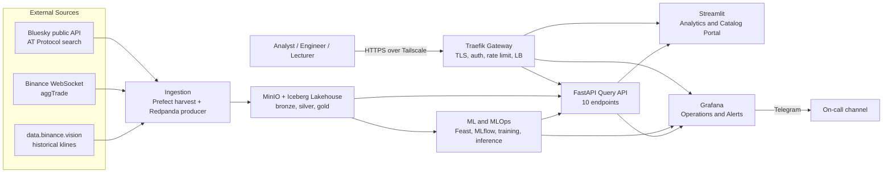

### 4.3 Container view by node

```mermaid
flowchart TB
    subgraph N1["N1 - Edge, Ingest, Storage, Query - 32 GB"]
        TR["Traefik v3"]
        RP["Redpanda"]
        MP["Market Producer"]
        SP["Stream Processor<br/>Polars + PyIceberg"]
        MN["MinIO"]
        PG1["PostgreSQL Core<br/>catalog + serving"]
        LK["Lakekeeper<br/>Iceberg REST catalog"]
        API1["FastAPI replica 1<br/>DuckDB"]
    end

    subgraph N2["N2 - Processing, Orchestration, ML - 16 GB"]
        PG2["PostgreSQL ML<br/>Prefect + MLflow + Feast"]
        PF["Prefect Server + Worker"]
        SH["Social Harvester"]
        DB["dbt-duckdb"]
        GX["Great Expectations"]
        MLF["MLflow"]
        FS["Feast"]
        TRN["Training and Inference Jobs"]
        API2["FastAPI replica 2<br/>DuckDB"]
    end

    subgraph N3["N3 - Governance and UI - 16 GB"]
        PG3["PostgreSQL Governance"]
        MQ["Marquez API + Web"]
        CAT["Catalog Portal"]
        ST["Streamlit Dashboard"]
    end

    subgraph N4["N4 - Observability and Security - 16 GB"]
        PR["Prometheus"]
        GF["Grafana"]
        LK2["Loki + Promtail"]
        PX["Postgres Exporter"]
        CA["cAdvisor"]
    end

    BSKY["Bluesky"] --> SH
    BIN["Binance WS"] --> MP
    BV["binance.vision"] --> MP
    PF --> SH
    SH --> MN
    SH --> PG1
    MP --> RP
    RP --> SP
    SP --> MN
    SP --> PG1
    LK --> MN
    API1 --> LK
    API2 --> LK
    API1 --> PG1
    API2 --> PG1
    PF --> DB
    DB --> MN
    DB --> PG1
    GX --> PG1
    PF --> MLF
    MLF --> MN
    PF --> FS
    FS --> MN
    FS --> PG2
    TRN --> MLF
    TRN --> PG1
    PF --> MQ
    DB --> MQ
    GX --> MQ
    CAT --> MQ
    CAT --> PG1
    ST --> API1
    PR --> API1
    PR --> API2
    PR --> RP
    PR --> MN
    GF --> PR
    TR --> API1
    TR --> API2
    TR --> ST
    TR --> CAT
    TR --> GF
```

### 4.4 Component responsibility matrix

| Required component | Owning services | Key outputs | Section |
|---|---|---|---|
| Lingkungan | Docker Compose, Tailscale, Traefik, volumes, secrets | Reproducible node roles and profiles | 5 |
| Ingestion | Bluesky harvester, Binance producer, Redpanda | Bronze objects, raw topics, watermarks | 7 |
| Processing | Stream processor, dbt-duckdb, PyIceberg | Silver tables, gold marts | 9 |
| Storage | MinIO, Lakekeeper, PostgreSQL | Iceberg warehouse, serving tables | 8 |
| Query Layer | FastAPI, DuckDB, PostgreSQL | Ten endpoints, OpenAPI contract | 10 |
| Machine Learning | Feast, MLflow, scikit-learn, XGBoost | Features, models, predictions, drift | 11 |
| Dashboard and Visualization | Streamlit, Grafana | Analytical and operational views | 15 |
| Alerting | Prometheus, Grafana Alerting, Telegram | Rules, notifications, runbooks | 16 |
| Security | Tailscale, Traefik, MinIO policies, Postgres roles, SOPS | Authenticated, authorized, audited access | 17 |
| Governance | Catalog portal, Marquez, metadata registry | Ownership, classification, lineage, retention | 14, 18 |
| Orchestration | Prefect | Schedules, dependencies, retries, backfills | 12 |

### 4.5 Technology rationale

| Layer | Chosen | Rejected alternative | Reason |
|---|---|---|---|
| Broker | Redpanda | Kafka + ZooKeeper | Single binary, no JVM, lower memory, Kafka API compatible |
| Stream processing | Python + Polars micro-batch | Spark Structured Streaming | 3-4 GB versus 400 MB; the data volume does not need a cluster |
| Batch transformation | dbt-duckdb + PyIceberg | Spark SQL | Same result at this scale, with lower operational cost |
| Table format | Iceberg | Delta Lake, Hudi | Best open ecosystem, REST catalog, DuckDB and PyIceberg support |
| Catalog service | Lakekeeper | Hive Metastore, Nessie, Polaris | Light Rust service, REST catalog, Postgres backend |
| Query | DuckDB behind FastAPI | Trino | Saves 3 GB and a JVM; the specification explicitly allows DuckDB plus an API |
| Orchestration | Prefect 3 | Airflow | Python-native, lighter, faster to author and debug |
| Catalog and lineage | Marquez | DataHub, OpenMetadata | About 1 GB versus 8-12 GB; OpenLineage-native |
| Quality | Great Expectations | Soda, Pandera only | Named in the brief, Data Docs, explicit suites and checkpoints |
| ML tracking | MLflow | Custom registry | Standard, light, registry aliases, artifact store on MinIO |
| Feature store | Feast | Custom tables | Standard offline/online abstraction and point-in-time joins |
| Gateway | Traefik v3 OSS | Kong, APISIX, Nginx Plus | Built-in LB, health checks, circuit breaker, retries, rate limit, Docker provider |
| Network | Tailscale | Docker Swarm, K3s, Consul | Works on Windows laptops, encrypted, stable IPs, no cluster to operate |
| BI | Streamlit + Grafana | Superset, Metabase | Two focused tools, lower memory, faster iteration |

### 4.6 Architecture decision records

The full ADRs live in `docs/adr/`. The index is:

| ADR | Decision | Status |
|---|---|---|
| ADR-001 | Bluesky instead of X for the batch source | Accepted |
| ADR-002 | Redpanda instead of Kafka | Accepted |
| ADR-003 | Polars and DuckDB instead of Spark | Accepted |
| ADR-004 | Iceberg with Lakekeeper as the lakehouse format and catalog | Accepted |
| ADR-005 | PyIceberg as the write path, DuckDB as the compute and read engine | Accepted |
| ADR-006 | Marquez plus a custom catalog portal instead of DataHub | Accepted |
| ADR-007 | Prefect instead of Airflow | Accepted |
| ADR-008 | Traefik as gateway, reverse proxy, load balancer, and circuit breaker | Accepted |
| ADR-009 | Tailscale instead of Swarm or Kubernetes networking | Accepted |
| ADR-010 | No HA claim; restart policies and tested RTO | Accepted |
| ADR-011 | PII pseudonymization at the silver boundary | Accepted |
| ADR-012 | Phase 1 uses VADER; phase 2 trains TF-IDF plus Logistic Regression | Accepted |

### 4.7 How this improves on the reference architecture

`Referensi.md` is a useful warning, not a template. Its stack is heavy for the available hardware and its guarantees are mostly cosmetic. The differences are deliberate:

| Dimension | Reference architecture | BMIP | Why it matters |
|---|---|---|---|
| Footprint | 18-20 services, roughly 40-60 GB, not comfortable on one laptop | About 11.5 GB in the dev profile, 20 GB across four nodes | The brief requires development on one laptop and a demo on two to four |
| Broker | Kafka plus ZooKeeper | Redpanda | One binary, no JVM, Kafka API, lower memory |
| Processing | Spark | Polars and DuckDB | The data volume is small; a cluster adds cost without adding correctness |
| Query | Trino | DuckDB behind FastAPI | Removes a multi-gigabyte JVM and matches the light option in the brief |
| Table format | Parquet files without a transactional table format | Apache Iceberg with a REST catalog | Real ACID, snapshots, time travel, schema evolution, and safe concurrent reads |
| Catalog and lineage | DataHub with mostly static or cosmetic lineage | Marquez with OpenLineage events plus a business registry | Runtime lineage from the jobs that actually ran |
| Quality | Ad hoc checks | Great Expectations suites, checkpoints, gates, Data Docs | Failures block promotion and leave evidence |
| Idempotency and replay | Not designed as a first-class property | Deterministic partitions, partition overwrite, replay flows | Re-running an hour is a normal operation, not an incident |
| Security | Keycloak, Vault, and many moving parts | Tailscale, Traefik, per-service credentials, Docker secrets, SOPS | Right-sized for four laptops and demonstrable |
| Availability | Implied or unproven HA | Explicit no-HA claim, restart policies, measured RTO | The brief accepts only proven HA claims |
| Visualization | Superset | Streamlit plus Grafana | One tool for analytics, one for operations, lower memory |
| Operations | Many services with no clear owner | Every service has a limit, a health check, an owner, and a runbook | A smaller platform that can actually be operated |

The comparison is not about brand preference. Each replacement removes a resource cost or adds a property the brief actually grades: local feasibility, open table semantics, lineage, quality gates, replay, and honest operations.

## 5. Environment and Deployment Topology

### 5.1 Node roles

The platform is one repository with four role-based Compose files. A node is not a different codebase; it is the same images with a different `.env` and a different Compose overlay.

| Node | RAM | Role | Always-on services | Why this node |
|---|---|---|---|---|
| N1 | 32 GB | Edge, ingestion, storage, query | Traefik, Redpanda, market producer, stream processor, MinIO, PostgreSQL Core, Lakekeeper, API replica 1 | Holds the hot path and the data. The largest RAM and disk. |
| N2 | 16 GB | Processing, orchestration, ML | PostgreSQL ML, Prefect server and worker, dbt, GX, MLflow, Feast, training and inference jobs, API replica 2 | CPU-heavy and bursty; isolated from the data node so a training job cannot starve ingestion |
| N3 | 16 GB | Governance and UI | PostgreSQL Governance, Marquez API and web, catalog portal, Streamlit | Read-mostly, user-facing, independent failure domain |
| N4 | 16 GB | Observability and security | Prometheus, Grafana, Loki, Promtail, exporters, optional Dex and oauth2-proxy, Toxiproxy, backup job | Watches the other nodes; must survive their failure |

Development baseline measured on the primary laptop: Windows 11, 32 GB RAM, Intel Core Ultra 7 155H, 750 GB SSD, Docker Desktop 29.2.1, Compose v5.0.2, WSL2 Ubuntu 24.04. Docker Desktop must be running before `make dev-up`; the initial environment check found the daemon stopped, so this is the first item in the day-one checklist.

### 5.2 Deployment profiles

| Profile | Laptops | Composition | Intended use |
|---|---|---|---|
| `dev` | 1 (32 GB) | All roles on one host; one API replica; Loki and Dex off; retention shortened to 3 days; resource limits tightened | Daily development and debugging |
| `two-node` | 2 | N1 hot path; N2 combines processing, ML, governance, UI, and observability | Minimum demo if a laptop fails |
| `three-node` | 3 | N1 hot path; N2 processing and ML; N3 governance, UI, and observability | Fallback demo |
| `four-node` | 4 | As designed in Section 5.1 | Full demo |

Switching profile is a command, not a rewrite:

```bash
make dev-up
make node1-up
make node2-up
make node3-up
make node4-up
make two-node-up
```

### 5.3 Service inventory

Memory values are Compose limits, not requests. Jobs are started by Prefect and exit after completion.

| Service | Image | Node | Purpose | Host ports | Mem limit | Persistent volume | Health check |
|---|---|---|---|---|---|---|---|
| `traefik` | `traefik:v3` | N1 | Ingress, gateway, LB, CB | 80, 443, 8082 | 0.2 GB | none | `/ping` |
| `redpanda` | `redpandadata/redpanda` | N1 | Event broker | 9092, 9644 | 1.2 GB | `redpanda-data` | `rpk cluster health` |
| `market-producer` | `bmip/ingest` | N1 | Binance WS or replay to Redpanda | none | 0.2 GB | none | heartbeat file |
| `social-harvester` | `bmip/ingest` | N2 | Prefect job for Bluesky harvest | none | 0.3 GB | none | exit 0 |
| `stream-processor` | `bmip/processor` | N1 | Micro-batch OHLC and features | none | 0.8 GB | none | heartbeat + metrics |
| `minio` | `minio/minio` | N1 | S3-compatible object storage | 9000, 9001 | 0.8 GB | `minio-data` | `/minio/health/live` |
| `minio-init` | `minio/mc` | N1 | Buckets, users, policies | none | 0.1 GB | none | exit 0 |
| `postgres-core` | `postgres:16` | N1 | Iceberg catalog, serving marts, audit | 5432 | 0.5 GB | `pg-core-data` | `pg_isready` |
| `lakekeeper` | `lakekeeper/catalog` | N1 | Iceberg REST catalog | 8181 | 0.3 GB | none | `/health` |
| `lakekeeper-bootstrap` | `bmip/ops` | N1 | Create warehouse and namespaces | none | 0.1 GB | none | exit 0 |
| `api-1` | `bmip/api` | N1 | Query API replica | 8000 | 0.7 GB | none | `/health/ready` |
| `postgres-ml` | `postgres:16` | N2 | Prefect, MLflow, Feast metadata | 5432 | 0.5 GB | `pg-ml-data` | `pg_isready` |
| `prefect-server` | `prefecthq/prefect:3` | N2 | Orchestration API and UI | 4200 | 0.9 GB | none | `/api/health` |
| `prefect-worker` | `prefecthq/prefect:3` | N2 | Executes flows | none | 0.5 GB | `work` | process check |
| `mlflow` | `ghcr.io/mlflow/mlflow` | N2 | Tracking and registry | 5000 | 0.6 GB | none (artifacts in MinIO) | `/health` |
| `feast` | `bmip/feast` | N2 | Optional feature server | 6566 | 0.2 GB | `feast-registry` | `/health` |
| `api-2` | `bmip/api` | N2 | Query API replica | 8000 | 0.7 GB | none | `/health/ready` |
| `dbt` | `bmip/dbt` | N2 | Gold transformations (job) | none | 0.5 GB | none | exit 0 |
| `gx` | `bmip/gx` | N2 | Quality suites (job) | none | 0.6 GB | none | exit 0 |
| `trainer` | `bmip/ml` | N2 | Training and retraining (job) | none | 2.0 GB | none | exit 0 |
| `inference` | `bmip/ml` | N2 | Batch inference (job) | none | 0.7 GB | none | exit 0 |
| `postgres-gov` | `postgres:16` | N3 | Marquez metadata | 5432 | 0.4 GB | `pg-gov-data` | `pg_isready` |
| `marquez-api` | `marquezproject/marquez` | N3 | OpenLineage API | 5002 | 0.4 GB | none | `/api/v1/namespaces` |
| `marquez-web` | `marquezproject/marquez-web` | N3 | Lineage UI | 3002 | 0.2 GB | none | HTTP 200 |
| `catalog-portal` | `bmip/catalog` | N3 | Search, metadata, lineage | 8502 | 0.4 GB | none | `/_stcore/health` |
| `streamlit` | `bmip/dashboard` | N3 | Analytics dashboard | 8501 | 0.4 GB | none | `/_stcore/health` |
| `prometheus` | `prom/prometheus` | N4 | Metrics storage and scraping | 9090 | 0.7 GB | `prometheus-data` | `/-/healthy` |
| `grafana` | `grafana/grafana` | N4 | Dashboards and alerting | 3000 | 0.4 GB | `grafana-data` | `/api/health` |
| `loki` | `grafana/loki` | N4 | Log aggregation (optional) | 3100 | 0.5 GB | `loki-data` | `/ready` |
| `promtail` | `grafana/promtail` | each | Log shipping (optional) | none | 0.1 GB | none | process check |
| `pushgateway` | `prom/pushgateway` | N4 | Batch job metrics | 9091 | 0.1 GB | none | `/-/healthy` |
| `postgres-exporter` | `prometheuscommunity/postgres-exporter` | N4 | Database metrics | 9187 | 0.1 GB | none | `/metrics` |
| `dex` | `dexidp/dex` | N4 | OIDC provider (optional) | 5556 | 0.1 GB | none | `/healthz` |
| `oauth2-proxy` | `oauth2-proxy/oauth2-proxy` | N4 | SSO forward auth (optional) | 4180 | 0.1 GB | none | `/ping` |
| `toxiproxy` | `shopify/toxiproxy` | N4 | Latency and failure injection (chaos profile) | 8474, 8666 | 0.1 GB | none | `/version` |
| `cadvisor` | `gcr.io/cadvisor/cadvisor` | each | Container metrics | 8080 | 0.2 GB | `/var/run` read-only | `/healthz` |
| `backup` | `bmip/ops` | N4 | Nightly `pg_dump` and manifest | none | 0.1 GB | none | exit 0 |

### 5.4 Resource budget

| Node | Steady state | Peak with jobs | RAM available | Headroom |
|---|---|---|---|---|
| N1 | 4.6 GB | 6.0 GB | 32 GB | Large |
| N2 | 4.0 GB | 7.0 GB | 16 GB | Adequate if jobs are serialized |
| N3 | 2.0 GB | 2.5 GB | 16 GB | Large |
| N4 | 2.4 GB | 3.0 GB | 16 GB | Large |
| Dev all-in-one | 11.5 GB | 14.0 GB | 32 GB | Comfortable |

The rule that keeps N2 safe: **only one heavy job at a time**. Prefect work pools use a concurrency limit of one for `trainer` and one for `dbt` plus `gx`. DuckDB and PyIceberg also require a single writer per table, so this rule solves two problems at once.

### 5.5 Network design

#### 5.5.1 Tailscale topology

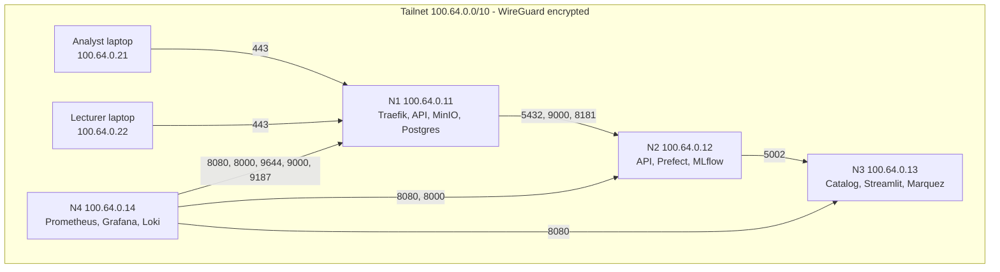

Rules:

- Tailscale runs on the Windows host, not inside Docker. Containers publish ports on `0.0.0.0`; the host forwards them to the tailnet.
- Each node has a stable `100.x` address. The addresses are written into `deploy/env/nodeN.env` and `deploy/services.yaml`.
- MagicDNS is convenient but **not reliable inside containers**. Containers use explicit `extra_hosts` entries or `100.x` addresses. Humans use names such as `n1.bmip.ts.net`.
- Only ports listed in the port map are exposed. Everything else stays on the Docker bridge.
- Tailscale ACLs restrict which tags can reach which ports. No service is exposed to the public internet.

#### 5.5.2 Tailscale ACL example

```json
{
  "tagOwners": {
    "tag:bmip-core": ["autogroup:admin"],
    "tag:bmip-ui": ["autogroup:admin"],
    "tag:bmip-user": ["autogroup:admin"]
  },
  "acls": [
    { "action": "accept", "src": ["tag:bmip-user"], "dst": ["tag:bmip-core:443"] },
    { "action": "accept", "src": ["tag:bmip-core"], "dst": ["tag:bmip-core:5432,9000,8181,8000,9092"] },
    { "action": "accept", "src": ["tag:bmip-core"], "dst": ["tag:bmip-ui:5002"] },
    { "action": "accept", "src": ["tag:bmip-ui"], "dst": ["tag:bmip-core:8000,9000,8181,5432"] },
    { "action": "accept", "src": ["tag:bmip-core"], "dst": ["tag:bmip-ui:8080"] },
    { "action": "accept", "src": ["tag:bmip-core"], "dst": ["tag:bmip-ui:3100"] }
  ]
}
```

The exact ACL is refined during implementation. The principle is deny-by-default and port-level least privilege.

#### 5.5.3 Windows firewall

Docker Desktop publishes ports on the Windows host, but Windows Firewall and, in some WSL configurations, the Hyper-V firewall still filter inbound traffic. The setup script adds scoped rules:

```powershell
New-NetFirewallRule -DisplayName "BMIP Tailscale" `
  -Direction Inbound -Protocol TCP `
  -LocalPort 443,8000,8082,9000,9001,9092,9644,8181,5432,5002,8080,9091,3100,9187 `
  -RemoteAddress 100.64.0.0/10 -Action Allow
```

If Docker Desktop uses mirrored WSL networking, add the equivalent Hyper-V rule. If it uses the default NAT, the Windows rule is enough. This is verified on day one, not on demo day.

#### 5.5.4 Docker networks

| Network | Members | Internet access | Notes |
|---|---|---|---|
| `edge` | Traefik, API, Streamlit, catalog portal, Grafana, MinIO console | No | User-facing ingress |
| `egress` | market producer, Bluesky harvester, Grafana, Prefect worker | Yes | Only services that must reach the internet |
| `data` | MinIO, PostgreSQL, Lakekeeper, Redpanda | No | Internal only |
| `ml` | Prefect, MLflow, Feast, jobs | No | Internal only |
| `obs` | Prometheus, Grafana, Loki, exporters | No | Internal only |

`data`, `ml`, and `obs` are declared `internal: true`. This is a deliberate security control: a compromised dashboard cannot reach the database directly.

#### 5.5.5 DNS and certificates

- UI hostnames: `api.bmip.local`, `app.bmip.local`, `catalog.bmip.local`, `grafana.bmip.local`, `prefect.bmip.local`, `mlflow.bmip.local`, `marquez.bmip.local`, `minio.bmip.local`, `docs.bmip.local`.
- Each client machine gets a hosts-file entry pointing all names to `100.64.0.11`. This is a five-line setup, documented in `docs/install.md`.
- TLS: `mkcert` creates a local CA and a wildcard certificate for `*.bmip.local`. The CA is installed on the four laptops and on the lecturer's machine. Tailscale-issued certificates for `*.ts.net` are an alternative if the hosts-file approach is inconvenient.
- Binance DNS: the local ISP poisons `api.binance.com` and `stream.binance.com`. The producer uses a DNS resolver configured to `1.1.1.1`, or Tailscale's DNS override, or the replay adapter. This is an environment setting, not a code change. The measured behaviour is recorded here so that the constraint is not forgotten: the poisoned answers point to `114.7.173.245` and `114.7.173.246` (`internetpositif.ioh.co.id`), while DoH returns working addresses. `data.binance.vision` is reachable without a workaround.

#### 5.5.6 Port map

| Port | Service | Node | Exposure |
|---|---|---|---|
| 80, 443 | Traefik | N1 | Tailnet users |
| 8082 | Traefik metrics | N1 | Prometheus |
| 8000 | FastAPI | N1, N2 | Traefik, Prometheus |
| 9000 | MinIO S3 | N1 | Internal nodes |
| 9001 | MinIO console | N1 | Traefik only |
| 9092 | Redpanda Kafka API | N1 | Internal nodes |
| 9644 | Redpanda admin and metrics | N1 | Prometheus |
| 8181 | Lakekeeper | N1 | Internal nodes |
| 5432 | PostgreSQL Core | N1 | API on N2, backup |
| 5432 | PostgreSQL ML | N2 | Local services |
| 5432 | PostgreSQL Governance | N3 | Local services |
| 4200 | Prefect | N2 | Traefik only |
| 5000 | MLflow | N2 | Traefik only |
| 5002 | Marquez API | N3 | N1, N2, Traefik |
| 3002 | Marquez web | N3 | Traefik only |
| 8501 | Streamlit | N3 | Traefik only |
| 8502 | Catalog portal | N3 | Traefik only |
| 3000 | Grafana | N4 | Traefik only |
| 9090 | Prometheus | N4 | Traefik only, admin |
| 3100 | Loki | N4 | Promtail, Grafana |
| 8080 | cAdvisor | each | Prometheus |
| 9091 | Pushgateway | N4 | Jobs, Prometheus |
| 9187 | Postgres exporter | N4 | Prometheus |
| 5556 | Dex | N4 | Traefik only, optional |
| 4180 | oauth2-proxy | N4 | Traefik only, optional |
| 8474, 8666 | Toxiproxy | N4 | Chaos profile only |
| 6566 | Feast server | N2 | Local jobs, optional |

### 5.6 Compose structure

```
deploy/
  compose.base.yml          # networks, volumes, logging, common anchors
  compose.dev.yml           # all roles on one host, reduced limits
  compose.node1.yml         # edge, ingest, storage, query
  compose.node2.yml         # processing, orchestration, ML
  compose.node3.yml         # governance, UI
  compose.node4.yml         # observability, security
  compose.jobs.yml          # dbt, GX, trainer, inference job definitions
  compose.chaos.yml         # Toxiproxy and fault-injection helpers
  env/
    common.env
    node1.env
    node2.env
    node3.env
    node4.env
  traefik/
    traefik.yml             # static configuration
    dynamic.yml             # routers, services, middlewares
  services.yaml             # source of truth for cross-node addresses
  minio/
    policies/               # per-service bucket policies
  postgres/
    init/                   # roles, databases, schemas
  prometheus/
    prometheus.yml
    alerts.yml
  grafana/
    provisioning/
    dashboards/
```

Design rules:

- `compose.base.yml` owns networks, volumes, logging, restart policy, and shared environment. Role files only add services.
- Every service declares `mem_limit`, `cpus`, `healthcheck`, `restart: unless-stopped`, and a logging limit.
- No service uses the `latest` tag. Images are pinned by digest at release time.
- No secret is written in a Compose file. Secrets come from `env/` files that are gitignored, or Docker secrets.
- `services.yaml` is generated or edited once per demo and consumed by the Traefik file provider and the `.env` files.

### 5.7 Startup order and dependencies

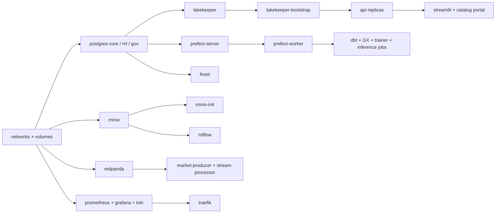

Rules:

- `depends_on` uses `condition: service_healthy`, not just `service_started`.
- Traefik starts last. If it starts first, it simply has no healthy backends; this is safe but noisy.
- The stream processor waits for Redpanda and Lakekeeper. It does not wait for Prefect; it is a long-running service, not a flow.
- Jobs are not started by Compose. Prefect starts them through a work pool so that retries, concurrency limits, and logs are centralized.
- The `minio-init` and `lakekeeper-bootstrap` jobs are idempotent and re-runnable.

### 5.8 Persistence, backup, and restore

| Volume | Contents | Backup | Retention |
|---|---|---|---|
| `minio-data` | Lakehouse, artifacts, docs, backups | MinIO versioning plus weekly manifest | 14 days hot, 90 days for gold |
| `pg-core-data` | Lakekeeper catalog, serving marts, audit | `pg_dump` daily to `s3://backups/postgres/core/` | 14 daily, 4 weekly |
| `pg-ml-data` | Prefect, MLflow, Feast | `pg_dump` daily | 14 daily, 4 weekly |
| `pg-gov-data` | Marquez | `pg_dump` daily | 14 daily |
| `redpanda-data` | Topics and consumer offsets | Not backed up; replayable from sources | 7 days topic retention |
| `prometheus-data` | Metrics | Not backed up; 15-day retention | 15 days |
| `grafana-data` | Dashboards and users | Provisioned as code plus `pg_dump`-style export | Git |

Restore procedure:

1. Stop the affected service and its dependants.
2. Restore the latest dump into a fresh database.
3. Restart Lakekeeper and verify the catalog lists the expected namespaces and tables.
4. Run `dbt source freshness` and the critical GX suites.
5. Verify the API `/health/ready` and one known query.
6. Record the restore time and the RTO in `evidence/recovery/`.

A restore is tested at least once before the demo. A backup that has never been restored is only a hypothesis.

### 5.9 Configuration and secrets

- `.env.example` is committed. `.env` is gitignored.
- Each node has `deploy/env/nodeN.env`. The file contains the node's Tailscale IP, peer IPs, service ports, and paths. It does not contain passwords.
- Passwords are Docker secrets or SOPS-encrypted files. Local development may use `.env` for convenience, but the demo uses secrets.
- MinIO: a root credential is used only by `minio-init`. Application users are created with policies:
  - `svc-ingest`: write `bronze/*`, write `quarantine/*`, read own bucket only.
  - `svc-process`: read `bronze/*`, write `silver/*`.
  - `svc-dbt`: read `silver/*`, write `gold/*`.
  - `svc-ml`: read `silver/*` and `gold/*`, write `artifacts/*`, read `mlflow/*`.
  - `svc-api`: read `gold/*` and `artifacts/*`; no write.
  - `svc-docs`: write `docs/*`.
  - `svc-backup`: write `backups/*`.
- PostgreSQL: one role per service, one database per bounded context. No application uses the `postgres` superuser.
- Rotation: demo credentials are rotated after the demo. The procedure is in `docs/runbooks/rotate-secrets.md`.

### 5.10 Operations runbook

| Task | Command |
|---|---|
| Start a node | `make node1-up` |
| Stop a node | `make node1-down` |
| Show health | `make health` |
| Tail logs | `make logs SERVICE=stream-processor` |
| Restart one service | `docker compose -f deploy/compose.node1.yml restart api-1` |
| Replay an hour | `make replay DATE=2026-11-10 HOUR=14` |
| Backfill social | `make backfill-social FROM=2026-11-01 TO=2026-11-07` |
| Run DQ suite | `make dq SUITE=silver_market` |
| Retrain | `make train MODEL=volatility` |
| Promote model | `make promote MODEL=volatility VERSION=3` |
| Backup now | `make backup` |
| Verify restore | `make restore-check` |
| Collect evidence | `make evidence` |

Every command has an entry in `docs/runbooks/`. Every alert links to the relevant runbook.

---

## 6. Data Sources and Contracts

### 6.1 Source inventory

| Source | Type | Endpoint or method | Event time field | Unique ID | Cadence |
|---|---|---|---|---|---|
| Bluesky public API | Batch | `GET https://api.bsky.app/xrpc/app.bsky.feed.searchPosts` | `record.createdAt` | `uri` (`at://...`) | Hourly harvest with backfill |
| Binance WebSocket | Stream | `wss://stream.binance.com:9443/stream?streams=btcusdt@aggTrade` | `E` or `T` in milliseconds | `a` (aggregate trade ID) | Continuous |
| Binance historical | Batch | `https://data.binance.vision/data/spot/monthly/klines/...` | `open_time` | `(symbol, open_time)` | On demand, monthly or daily files |
| Binance REST fallback | Batch | `GET /api/v3/aggTrades` | `T` | `a` | On demand for gap filling |

### 6.2 Licensing, legality, and personal data

| Source | License and terms | Personal data | Our control |
|---|---|---|---|
| Bluesky public data | AT Protocol public API. The Bluesky Terms of Service (updated 2025-08-14) contain no scraping or automated-access prohibition. Public posts are public by design. | Author DID, handle, display name, post text, engagement counts | Hash the author DID with a salted HMAC in silver; drop handle, display name, avatar, and profile data; the post URI also contains the DID, so silver stores only `post_key = HMAC-SHA256(salt, post_uri)` and not the raw URI; keep post text internal; never republish raw text in the public demo; delete by `post_key` when a post is removed upstream. |
| Binance market data | Public market data. `data.binance.vision` is Binance's official public dataset endpoint. | None | Keep the source and retrieval date in metadata. Do not redistribute as a standalone dataset. |
| X/Twitter | Not used. The official API is pay-per-use, and scraping violates the X Terms of Service. At design time, reads were about $0.005 per post, there was no practical free tier, and the recent search window was seven days; a $20 credit covers roughly 4,000 posts. | Not applicable | Documented as a rejected alternative in ADR-001. |

Data limitations that must appear in the final report:

- Bluesky is not X. The volume of crypto-related posts is smaller, and the user base differs. Sentiment findings may not generalize to X.
- The sentiment history is short at the start. The model is trained on the available overlap and re-evaluated as history grows.
- Binance data is exchange-specific. It is a proxy for global Bitcoin market activity, not the whole market.
- Public posts can be deleted. The platform respects deletion by URI on the next harvest, but derived aggregates may retain the effect until the next rebuild.
- The platform uses real source data. Synthetic or generated records are not used to satisfy a requirement; test fixtures are clearly labelled and are never presented as production evidence.

### 6.3 Volume estimates

| Dataset | Raw size per day | 14 days hot | 90 days gold | Notes |
|---|---|---|---|---|
| Bluesky posts | 5-100 MB | 0.1-1.4 GB | Not applicable | 100-1,000 posts per hour assumed |
| Binance aggTrades | 50-400 MB | 0.7-5.6 GB | Not applicable | 0.5-2 million trades per day assumed |
| Silver OHLC and features | 5-20 MB | 0.1-0.3 GB | 1-2 GB | 1,440 minute rows per day |
| Gold marts | 1-5 MB | Negligible | 0.1-0.5 GB | Hourly and daily aggregates |
| MLflow artefacts | 5-50 MB per week | Not applicable | 1-2 GB | Models are small |
| Total | Under 500 MB per day | Under 8 GB | Under 5 GB | Fits comfortably on N1 |

### 6.4 Event-time semantics

| Timestamp | Meaning | Used for |
|---|---|---|
| `event_ts` | When the source produced the event | Windowing, joins, labels, freshness |
| `ingest_ts` | When BMIP received the event | Lag measurement, audit |
| `processing_ts` | When the transformation ran | Debugging, lineage facets |
| `window_start`, `window_end` | The event-time interval of an aggregate | OHLC, features, marts |

Rules:

- All timestamps are UTC and stored with timezone.
- Market watermark: `max(event_ts) - 2 minutes`. Events older than the watermark are "late". They are accepted and used to correct the affected minute if they arrive within 30 minutes; beyond that they go to quarantine and a backfill is scheduled.
- Social watermark: the last successfully harvested `created_at`. Each hourly run fetches `since = watermark - 5 minutes` to tolerate clock skew, then deduplicates by `uri`.
- Windows are half-open: `[window_start, window_end)`.
- The label window is strictly after the feature window. This is enforced by a DQ rule and a unit test.

### 6.5 Data contracts

Contracts live in `contracts/` as JSON Schema and Pydantic models. Producers validate before publishing; consumers validate before writing to silver. The social contract describes the bronze record. Silver replaces the raw `post_uri` with a keyed hash, `post_key`, and does not carry the raw URI forward.

**Social post, contract `social_post.v1`:**

| Field | Type | Required | Rule |
|---|---|---|---|
| `post_uri` | string | yes | Unique, starts with `at://`, max 512 |
| `author_did` | string | yes | Hashed before silver |
| `author_handle` | string | no | Dropped at silver |
| `created_at` | timestamp | yes | Not in the future, not older than 30 days at ingest |
| `ingest_ts` | timestamp | yes | Greater than or equal to `created_at` minus 1 second |
| `lang` | string | no | BCP-47 or null |
| `text` | string | yes | 1-2,000 characters |
| `hashtags` | array of string | no | Normalized, max 20 |
| `like_count` | integer | yes | Greater than or equal to 0 |
| `repost_count` | integer | yes | Greater than or equal to 0 |
| `reply_count` | integer | yes | Greater than or equal to 0 |
| `quote_count` | integer | yes | Greater than or equal to 0 |
| `source` | string | yes | `bluesky` |
| `schema_version` | string | yes | `1.0` |
| `raw_ref` | string | yes | Bronze object path |
| `payload_hash` | string | yes | SHA-256 of the canonical raw payload |

**Market trade, contract `market_trade.v1`:**

| Field | Type | Required | Rule |
|---|---|---|---|
| `symbol` | string | yes | Allowlist, for example `BTCUSDT` |
| `trade_id` | int64 | yes | Unique per symbol |
| `event_ts` | timestamp | yes | Not in the future |
| `price` | decimal | yes | Greater than 0 |
| `qty` | decimal | yes | Greater than 0 |
| `is_buyer_maker` | boolean | yes | No rule |
| `ingest_ts` | timestamp | yes | Greater than or equal to `event_ts` minus 1 second |
| `source` | string | yes | `binance_ws`, `binance_vision`, or `binance_rest` |
| `schema_version` | string | yes | `1.0` |

The full JSON Schemas are in Appendix C. A contract change requires a version bump and a migration note. Backward-compatible changes only: add optional fields, never rename or retype a field in place.

### 6.6 Source adapters and failure modes

```python
class MarketFeed(Protocol):
    def stream(self) -> Iterator[TradeEvent]: ...
    def backfill(self, start: datetime, end: datetime) -> Iterator[TradeEvent]: ...
    def health(self) -> FeedHealth: ...

class SocialFeed(Protocol):
    def fetch(self, since: datetime, until: datetime) -> Iterator[SocialPost]: ...
    def backfill(self, start: datetime, end: datetime) -> Iterator[SocialPost]: ...
```

| Adapter | When used | Failure behaviour |
|---|---|---|
| `BinanceWebSocketFeed` | Normal live demo | Reconnect with exponential backoff; resume from the last committed trade ID; send a gap-fill request |
| `BinanceVisionReplayFeed` | DNS block, no internet, deterministic tests | Replays a historical window at configurable speed, preserving event time |
| `BinanceRestFeed` | Small gap fill | Paginated REST calls with rate limiting |
| `BlueskySearchFeed` | Normal harvest | Backoff on 403 or 429; walk backwards with `until`; alert after three failures |
| `StaticReplayFeed` | Unit and integration tests | Reads a fixture file; no network |

The adapter is selected by `MARKET_FEED` and `SOCIAL_FEED` environment variables. Switching from live to replay changes one variable and does not change downstream code.

### 6.7 Source-level quality

At ingestion, before anything is written to bronze:

- Parse the payload and validate it against the contract.
- Reject records with missing required fields, impossible timestamps, or non-positive prices.
- Compute a payload hash and store it for deduplication and audit.
- Attach `ingest_ts`, `source`, `schema_version`, and `raw_ref`.
- Route invalid records to `quarantine/` with the reason and the original payload.

## 7. Ingestion

### 7.1 Batch social ingestion

**Schedule:** hourly at minute 10, with a manual backfill deployment.

**Flow:**

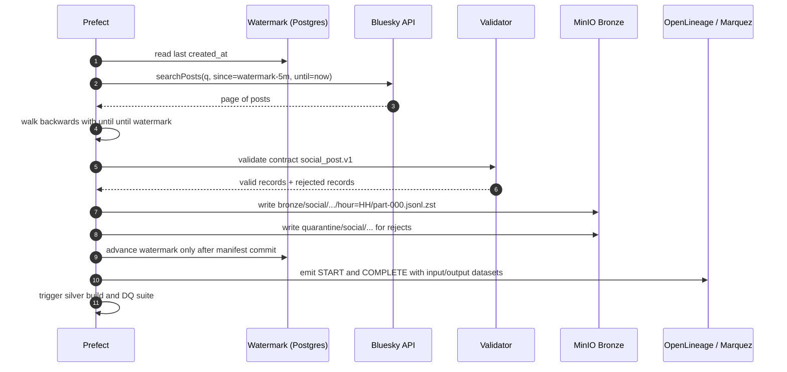

**Harvest algorithm:**

1. Read the watermark from `ops.social_watermark`.
2. Query `searchPosts` with `q` built from the crypto keyword set, `sort=latest`, `limit=100`, `since=watermark - 5 minutes`, `until=now`.
3. Paginate backwards using `until = oldest created_at` from the previous page. Stop when the oldest record is at or before the watermark, or after 50 pages.
4. Validate each record. Valid records go to bronze; invalid records go to quarantine with a reason.
5. Write one object per page under a deterministic hour partition. The object name is stable, so a re-run overwrites the same partition.
6. Write a `_manifest.json` listing the objects, row count, min/max `created_at`, and a content hash.
7. Advance the watermark only after the manifest is written. If the run fails before the manifest, the watermark does not move and the next run retries the same window.
8. Emit OpenLineage events and trigger the silver build.

**Why walk backwards:** unauthenticated `searchPosts` returns 403 for cursor requests. Walking backwards with `until` is the supported alternative. It also gives a natural boundary for backfill.

**Backfill:** `make backfill-social FROM=... TO=...` iterates hour by hour, calls the same harvest function with `since` and `until` fixed to the hour, and overwrites each partition. Because the partition key is deterministic, backfill is idempotent.

**Failure handling:**

- HTTP 403 or 429: exponential backoff (1, 2, 4, 8, 16 seconds), then fail the run. Three consecutive failed runs trigger an alert.
- Partial page: discard the page, do not advance the watermark, retry.
- Schema drift: if a required field disappears, quarantine the batch and fail the run. Do not silently write nulls.
- Clock skew: the five-minute overlap absorbs it. Deduplication by `uri` removes the overlap.

### 7.2 Stream market ingestion

**Producer:**

1. Connect to `wss://stream.binance.com:9443/stream?streams=btcusdt@aggTrade`.
2. Respond to ping frames within one minute; reconnect on close, with exponential backoff and jitter.
3. Parse the aggregate trade: `a` (trade ID), `p` (price), `q` (quantity), `T` (trade time), `m` (buyer is maker), `E` (event time).
4. Add `ingest_ts`, `source`, `schema_version`, and a `trace_id`.
5. Publish to `market.trades.raw` with key `symbol`, headers `schema_version` and `trace_id`, `acks=all`, and idempotent producer enabled.
6. On reconnect, request a REST gap fill from the last published trade ID to the current time. Publish the gap fill with `source=binance_rest`.

**Topic design:**

| Topic | Partitions | Replication | Retention | Cleanup | Key | Compression |
|---|---|---|---|---|---|---|
| `market.trades.raw` | 3 | 1 | 7 days | delete | `symbol` | zstd |
| `market.trades.dlq` | 1 | 1 | 7 days | delete | none | zstd |

Three partitions allow a consumer group to scale to three processors later. At this volume, one processor is enough, but the topic is ready for the distributed story.

**Consumer and micro-batch:**

- Consumer group: `ohlcv-builder`.
- Poll up to 1,000 records or 500 ms, whichever comes first.
- Deduplicate within the batch and against a small in-memory window keyed by `(symbol, trade_id)`.
- Buffer events by event time. A one-minute window is emitted when the watermark passes `window_end + 2 minutes`.
- Compute OHLC, volume, quote volume, trade count, VWAP, log return, and realized volatility.
- Write the raw micro-batch to bronze as Parquet.
- Upsert the affected minute in `silver.market_ohlcv_1m` and `silver.market_features_1m`.
- Commit the Redpanda offset only after the Iceberg commit succeeds.
- Emit metrics: events in, events out, parse errors, duplicates, late events, commit latency, consumer lag.

**Why micro-batch instead of a stream engine:** the output is a one-minute bar. A ten-second micro-batch adds at most ten seconds of latency, well inside the two-minute freshness target, and costs a fraction of a streaming cluster. The architecture still has a real broker, real consumer groups, offsets, event time, watermarks, and replay. The grading criteria are about correctness and evidence, not about the brand of the processing engine.

**Exactly-once, honestly:** the pipeline is at-least-once with idempotent writes. A failure after the Iceberg commit but before the offset commit causes a replay of the same batch, and the upsert produces the same result. This is "effectively once" for this dataset, and the document says so rather than claiming exactly-once delivery.

### 7.3 Replay and backfill

| Scenario | Method | Effect |
|---|---|---|
| Recompute one hour of social data | `make backfill-social FROM=... TO=...` | Partition overwrite, same row count for the same source data |
| Recompute one hour of market data | `make replay DATE=... HOUR=...` with `BinanceVisionReplayFeed` | Silver upsert, same OHLC values |
| Replay from the broker | Reset the consumer group offset to a timestamp | At-least-once reprocessing, idempotent upsert |
| Rebuild silver from bronze | `make rebuild-silver` | Reads bronze, recomputes silver, overwrites partitions |
| Rebuild gold from silver | `make build-gold` | dbt full refresh of the marts |

Replay uses a separate consumer group (`ohlcv-builder-replay`) writing to the same tables with the same business keys. It does not disturb the live consumer's offsets. Prefect holds a single-writer lock per table, so a replay cannot race a live write.

### 7.4 Duplicate, late, and malformed data

| Problem | Detection | Handling | Evidence |
|---|---|---|---|
| Duplicate trade | Same `(symbol, trade_id)` | Deduplicate in the batch, then upsert the minute; a DQ rule asserts uniqueness | Duplicate injection test |
| Duplicate post | Same `post_uri` | Deduplicate on read; partition overwrite keeps one copy | Duplicate injection test |
| Late trade | `event_ts < watermark` | Correct the minute if within 30 minutes; otherwise quarantine and schedule a backfill | Late event test with a shifted timestamp |
| Late post | `created_at` older than the harvested hour | The backfill walk picks it up; the hour is recomputed | Backfill test |
| Malformed JSON | Parse error | Quarantine with the raw payload and reason; increment a metric | Malformed payload test |
| Contract violation | Schema validation fails | Same as malformed; fail the run if the rate exceeds 1% | Contract test |
| Out-of-order events | Event time versus arrival order | Event-time windows, not arrival order | Out-of-order test |
| Clock skew | `ingest_ts - event_ts` negative or implausible | Warn, clamp for the metric, keep the event | Clock-skew test |

### 7.5 Offset and checkpoint semantics

- Redpanda offset is committed after the Iceberg commit.
- The Prefect flow uses a run-level idempotency key derived from the partition window.
- The social watermark is stored in PostgreSQL and advanced in the same transaction that records the manifest.
- The stream processor keeps no durable local state beyond the committed offset. On restart, it replays from the last committed offset and recomputes the last two minutes.
- A `_SUCCESS` manifest marks a bronze partition as complete. Readers ignore a partition without a manifest.

### 7.6 Ingestion SLOs and metrics

| Metric | Target | Alert |
|---|---|---|
| Market consumer lag | Under 5 seconds p95 | Warning at 60 seconds, critical at 5 minutes |
| Market freshness | Silver within 2 minutes p95 | Warning at 5 minutes, critical at 15 minutes |
| Social freshness | Bronze within 75 minutes | Warning at 90 minutes, critical at 3 hours |
| Duplicate rate | Under 0.01% of market events | Warning at 1% |
| Parse error rate | Under 0.1% | Warning at 1%, critical at 5% |
| Late event rate | Under 0.5% | Warning at 2% |
| Ingestion availability | 99% during the demo window | Critical if no events for 5 minutes |

---

## 8. Storage and Lakehouse

### 8.1 Buckets and layout

MinIO buckets:

| Bucket | Purpose | Versioning | Public |
|---|---|---|---|
| `lakehouse` | Bronze, silver, gold, Iceberg warehouse | Enabled | No |
| `artifacts` | MLflow artefacts and model files | Enabled | No |
| `docs` | GX Data Docs, dbt docs, generated reports | Disabled | Tailnet only, via Traefik |
| `backups` | PostgreSQL dumps and manifests | Enabled | No |
| `quarantine` | Rejected records | Disabled | No |

```text
s3://lakehouse/
  bronze/
    social/source=bluesky/event_date=2026-11-10/hour=14/part-000.jsonl.zst
    social/source=bluesky/event_date=2026-11-10/hour=14/_manifest.json
    market/source=binance_ws/event_date=2026-11-10/hour=14/part-<batch_start>.parquet
    klines/source=binance_vision/symbol=BTCUSDT/interval=1m/year=2026/month=10/
  quarantine/
    social/ingest_date=.../reason=schema_violation/...
    market/event_date=.../reason=late_beyond_window/...
  warehouse/
    bronze.db/
    silver.db/
    gold.db/
  gold/
    features/               # Parquet export consumed by the Feast offline store
s3://artifacts/mlflow/
s3://docs/gx/ , s3://docs/dbt/
s3://backups/postgres/
```

### 8.2 Iceberg catalog and tables

Lakekeeper is the REST catalog. Its metadata lives in `postgres-core`. The warehouse is `s3://lakehouse/warehouse/`.

| Table | Layer | Grain | Partition | Retention | Owner |
|---|---|---|---|---|---|
| `bronze.social_post_raw` | Bronze | One row per raw post | `event_date` | 14 days | Data engineering |
| `bronze.market_trade_raw` | Bronze | One row per trade | `event_date` | 14 days | Data engineering |
| `bronze.market_kline_raw` | Bronze | One row per minute kline | `event_date` | 14 days | Data engineering |
| `silver.social_post` | Silver | One row per unique post, keyed by `post_key` | `event_date` | 30 days | Data engineering |
| `silver.social_sentiment` | Silver | One row per scored post | `event_date` | 30 days | ML |
| `silver.market_trades` | Silver | One row per unique trade | `event_date` | 30 days | Data engineering |
| `silver.market_ohlcv_1m` | Silver | One row per symbol per minute | `event_date` | 30 days | Data engineering |
| `silver.market_features_1m` | Silver | One row per symbol per minute | `event_date` | 30 days | ML |
| `gold.mart_market` | Gold | One row per symbol per hour | `event_date` | 90 days | Analytics |
| `gold.mart_sentiment` | Gold | One row per hour | `event_date` | 90 days | Analytics |
| `gold.mart_ml` | Gold | One row per symbol per hour | `event_date` | 90 days | ML |
| `gold.predictions` | Gold | One row per symbol per hour | `event_date` | 90 days | ML |

All tables use Iceberg format version 2 for maximum compatibility with PyIceberg and DuckDB. Format v3 features are not needed.

### 8.3 Partitioning, file sizing, and compaction

- Partition by date. Hour-level partitioning creates too many small files for this volume. The hour is encoded in the file's statistics and in the `window_start` column, so predicate pushdown still works.
- For `market_trades`, partition by `event_date` and bucket by `symbol` if a second symbol is added. With one symbol, date is enough.
- Target file size: 128-256 MB, except bronze raw objects, which are naturally smaller.
- Small-file problem: the stream processor writes a micro-batch every ten seconds. Compaction runs daily at 01:00 UTC with PyIceberg `rewrite_data_files`, targeting 128 MB. The job is idempotent and reports files before and after.
- Snapshot expiry: keep seven days of snapshots for debugging and time travel. Expire older snapshots and remove orphan files weekly.
- Manifest rewriting: monthly or after a large backfill.

### 8.4 ACID, snapshots, time travel, and schema evolution

What the lakehouse gives the project, concretely:

- **Atomic commits:** a failed write does not leave a partially visible minute or hour.
- **Snapshot isolation:** readers see a consistent table while a writer commits.
- **Time travel:** a training run records the Iceberg snapshot ID and reads that snapshot through PyIceberg. DuckDB reads the current snapshot; the reproducible training path uses PyIceberg's snapshot API.
- **Schema evolution:** add optional columns without rewriting files. Field IDs are preserved.
- **Auditability:** every snapshot has a summary and a timestamp.
- **Open format:** any engine can read the table; the project is not locked into DuckDB.

Time-travel demo:

```python
# Reproduce the exact feature table used by a model version
table = catalog.load_table("gold.mart_ml")
snapshot = table.snapshot_by_id(4815162342)
arrow_table = table.scan(snapshot_id=snapshot.snapshot_id).to_arrow()
```

DuckDB is used for serving and ad-hoc queries on the current snapshot. PyIceberg is the reproducibility path for a recorded snapshot.

Schema evolution rules:

- Add columns at the end, with a default or nullable.
- Never rename or retype a column in place. Use a new column and a migration view.
- Bump the contract version when the change is not backward compatible.
- Record the change in the catalog registry and in the data contract changelog.

### 8.5 Retention and lifecycle

| Layer | Hot retention | After retention | Rationale |
|---|---|---|---|
| Bronze | 14 days | Delete files and expire snapshots | Raw data is replayable from sources; keep enough for debugging |
| Silver | 30 days | Delete older partitions | Enough for recent backfills and joins |
| Gold | 90 days | Keep aggregates; delete raw detail if needed | ML training history and dashboards |
| MLflow artefacts | 90 days | Keep champion and last five challengers | Reproducibility |
| Logs | 14 days | Delete | Debugging window |
| Backups | 14 daily plus 4 weekly | Delete | Recovery window |

The 90-day gold retention is deliberate. The user's hot-retention preference is 7-14 days for raw data; derived aggregates are much smaller and are what the model needs for a meaningful history. The document states this explicitly rather than silently keeping everything.

### 8.6 Write path and concurrency

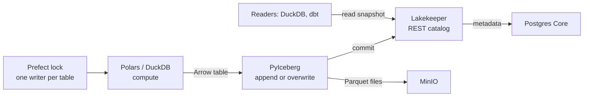

Rules:

1. **One writer per table at a time.** Prefect uses a named lock per table. A second writer waits or fails fast.
2. **DuckDB never writes a shared `.duckdb` file across nodes.** It reads Iceberg or Parquet and writes results as Arrow.
3. **PyIceberg performs the commit.** It retries on commit conflicts and surfaces a clear error after three attempts.
4. **Partition overwrite is the idempotency primitive.** Recomputing an hour replaces that hour's files and produces the same logical table.
5. **Readers use snapshots.** A long-running query is not affected by a concurrent commit.
6. **Compaction is a writer.** It takes the same lock and runs outside the ingestion window.

### 8.7 PostgreSQL serving and operational tables

Iceberg is excellent for history and reproducibility. It is not the lowest-latency store for "latest value" queries from a dashboard. PostgreSQL holds a small, indexed serving copy plus the operational state that drives the pipeline.

| Table | Grain | Refresh | Index |
|---|---|---|---|
| `serving.market_latest` | One row per symbol | Every minute | `(symbol)` |
| `serving.market_ohlcv` | One row per symbol per hour, last 30 days | Hourly | `(symbol, window_start)` |
| `serving.sentiment_1h` | One row per hour, last 30 days | Hourly | `(window_start)` |
| `serving.predictions` | One row per symbol per hour | Hourly | `(symbol, window_start)` |
| `serving.model_metrics` | One row per model version per evaluation | On training | `(model_name, version)` |
| `serving.model_decisions` | One row per promotion decision | On training | `(model_name, decision_ts)` |
| `serving.drift_metrics` | One row per feature per day | Daily | `(feature, metric_date)` |
| `serving.dq_results` | One row per expectation result | On DQ run | `(suite, rule, run_ts)` |
| `serving.dq_summary` | One row per suite per run | On DQ run | `(suite, run_ts)` |
| `ops.social_watermark` | One row per source | On harvest | `(source)` |
| `ops.pipeline_runs` | One row per flow run | On flow event | `(flow, run_ts)` |
| `serving.catalog_datasets` | One row per dataset, a view over the registry | On registration | `(name)` |

`serving.catalog_datasets` is a read view over `governance.dataset_registry`, which is the source of truth for business metadata. The serving tables are owned by the publish task, not by ad-hoc queries. The API reads them through a read-only role.

### 8.8 Capacity

| Item | Estimate |
|---|---|
| MinIO data after 14 days | 3-8 GB |
| Gold after 90 days | 1-2 GB |
| MLflow artefacts | 1-2 GB |
| PostgreSQL core | Under 1 GB |
| PostgreSQL ML | Under 1 GB |
| PostgreSQL governance | Under 1 GB |
| Logs and metrics | 2-5 GB |
| Total disk on N1 | Under 20 GB used, 100 GB recommended |

N1 should have at least 100 GB free. A 256 GB SSD is comfortable. The other nodes need less than 50 GB each.

## 9. Processing and Medallion Layers

### 9.1 Layer definitions

| Layer | Question it answers | Contents | Rules |
|---|---|---|---|
| Bronze | What did we receive, exactly? | Raw JSONL or Parquet, immutable, one object set per source and hour | No business transformation; contract validation only; keep the raw payload; write a manifest |
| Silver | What is true, deduplicated, and conformed? | Typed, cleaned, deduplicated, pseudonymized posts; trades; one-minute OHLC; features; sentiment scores | Unique business keys; event-time windows; PII removed; quality-gated |
| Gold | What does the business need? | Three hourly marts for market, sentiment, and ML | Aggregated, documented, tested, owned, lineage-tracked |
| Serving | What does the API read? | Indexed PostgreSQL tables for low-latency reads | Derived from gold; refresh tracked; read-only role |

### 9.2 Stream processing algorithm

```python
while running:
    records = consumer.poll(max_records=1000, timeout_ms=500)
    events = [parse(r) for r in records]
    valid, rejected = validate_contract(events)

    dedupe(valid, key=lambda e: (e.symbol, e.trade_id))
    watermark = max(e.event_ts for e in valid) - timedelta(minutes=2)

    # Correct late events inside the correction window.
    for e in valid:
        if e.event_ts < watermark - timedelta(minutes=30):
            quarantine(e, reason="late_beyond_window")
        else:
            update_window_state(e)

    ready = [w for w in window_state if w.end + timedelta(minutes=2) <= watermark]
    for window in ready:
        ohlcv = aggregate_ohlcv(window)
        features = compute_features(ohlcv, history=feature_cache)
        with table_lock("silver.market_ohlcv_1m"):
            iceberg.overwrite(ohlcv, filter=window.key)
        with table_lock("silver.market_features_1m"):
            iceberg.overwrite(features, filter=window.key)

    write_bronze_microbatch(valid)
    write_quarantine(rejected)
    consumer.commit()          # only after the Iceberg commits succeed
    emit_metrics()
```

**Feature computation at minute `t`:**

| Feature | Definition |
|---|---|
| `ret_1m` | `ln(close_t / close_{t-1})` |
| `ret_5m`, `ret_15m`, `ret_60m` | Log return over the trailing window |
| `rv_5m`, `rv_15m`, `rv_60m` | Standard deviation of one-minute log returns, annualization optional |
| `hl_range_1m` | `(high - low) / close` |
| `volume_z_60m` | `(volume_t - mean_60m) / std_60m` |
| `trade_count_60m` | Sum of trade counts in the trailing hour |
| `vwap_dev` | `(close - vwap_60m) / vwap_60m` |
| `sent_mean_1h` | Mean sentiment score of posts in the previous hour |
| `sent_pos_share`, `sent_neg_share` | Share of positive and negative posts |
| `post_count_1h` | Number of posts in the previous hour |
| `engagement_1h` | Likes plus reposts plus replies per post |

All rolling features use data at or before `window_end`. The sentiment features use `created_at`, not ingest time. This is the first line of defense against leakage.

### 9.3 Batch transformations

dbt-duckdb is the transformation layer for gold. It reads silver through an attached Iceberg catalog or `iceberg_scan`, and writes gold as Iceberg tables or external Parquet that PyIceberg registers.

Model layout:

```text
models/
  staging/
    stg_social_post.sql
    stg_market_trades.sql
    stg_market_klines.sql
  intermediate/
    int_social_sentiment_1h.sql
    int_market_ohlcv_1h.sql
    int_market_features_1h.sql
  marts/
    mart_market.sql
    mart_sentiment.sql
    mart_ml.sql
  serving/
    serving_market_latest.sql
    serving_predictions.sql
  schema.yml
```

Materializations:

- Staging and intermediate: views or temporary tables; no storage cost.
- Marts: Iceberg tables, partitioned by `event_date`.
- Serving: external Parquet in `s3://lakehouse/serving/`, loaded into PostgreSQL by the `publish_serving` task.

Why not write PostgreSQL directly from dbt: dbt-duckdb's PostgreSQL attachment is useful for reads, but the publish step also needs idempotent upserts, index management, and a transaction boundary. A small Python task with `psycopg` is clearer and easier to test.

### 9.4 The three marts

**`gold.mart_market`** is the business view of the market.

| Column | Type | Description |
|---|---|---|
| `symbol` | string | Trading pair |
| `window_start` | timestamp | Start of the hour |
| `open`, `high`, `low`, `close` | decimal | Hourly OHLC from one-minute bars |
| `volume`, `quote_volume` | decimal | Hourly totals |
| `trade_count` | bigint | Number of trades in the hour |
| `vwap` | decimal | Volume-weighted average price |
| `log_return_1h` | double | Hourly log return |
| `realized_vol_1h` | double | Standard deviation of one-minute log returns |
| `rv_ewma_24h` | double | Exponentially weighted volatility over 24 hours |
| `source` | string | `binance_ws`, `binance_vision`, or mixed |
| `updated_at` | timestamp | Last materialization time |

**`gold.mart_sentiment`** is the business view of social sentiment.

| Column | Type | Description |
|---|---|---|
| `window_start` | timestamp | Start of the hour |
| `post_count` | integer | Number of unique posts |
| `unique_authors` | integer | Number of unique pseudonymized authors |
| `mean_sentiment` | double | Mean score in `[-1, 1]` |
| `positive_share`, `negative_share`, `neutral_share` | double | Class shares |
| `total_likes`, `total_reposts`, `total_replies` | bigint | Engagement totals |
| `engagement_per_post` | double | Engagement normalized by post count |
| `top_hashtags` | array of string | Top five hashtags by frequency |
| `sentiment_model_version` | string | Model or lexicon version |
| `updated_at` | timestamp | Last materialization time |

**`gold.mart_ml`** is the training and inference dataset.

| Column | Type | Description |
|---|---|---|
| `symbol` | string | Trading pair |
| `window_start` | timestamp | Feature window start (hour) |
| `ret_5m`, `ret_15m`, `ret_60m` | double | Trailing returns |
| `rv_5m`, `rv_15m`, `rv_60m` | double | Trailing realized volatility |
| `volume_z_60m` | double | Volume z-score |
| `trade_count_60m` | bigint | Trailing trade count |
| `hl_range_1m` | double | High-low range |
| `vwap_dev` | double | VWAP deviation |
| `sent_mean_1h`, `sent_pos_share`, `sent_neg_share` | double | Sentiment features |
| `post_count_1h` | integer | Social volume |
| `engagement_1h` | double | Engagement per post |
| `label_rv_next_1h` | double | Realized volatility over `(window_start, window_start + 1h]` |
| `label_start`, `label_end` | timestamp | Label window boundaries |
| `feature_snapshot_id` | string | Iceberg snapshot used to build the row |
| `dq_status` | string | `pass` or `warn` |

### 9.5 Transformation DAG

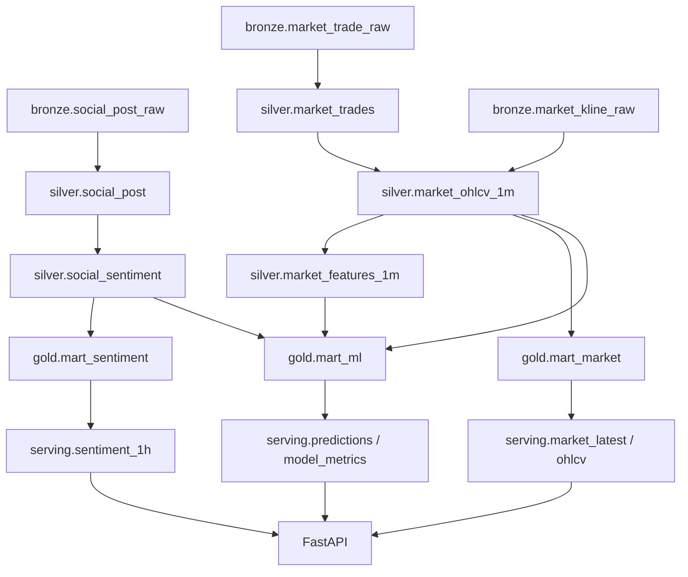

### 9.6 Idempotency and replay

| Operation | Key | Behaviour on re-run |
|---|---|---|
| Bronze social batch | `batch_id` + `checksum` | Identical replay returns `skipped_identical`; no duplicate rows |
| Bronze market micro-batch | `(source, event_date, hour, batch_start)` | A deterministic part name per batch; a replay overwrites the same batch object |
| Silver OHLC minute | `(symbol, window_start)` | Partition overwrite of the affected minute |
| Silver features minute | `(symbol, window_start)` | Partition overwrite |
| Silver social post | `(post_key)` | Overwrite the affected hour |
| Gold mart hour | `(symbol, window_start)` or `(window_start)` | dbt full refresh or partition overwrite |
| Serving table | Primary key | Upsert inside a transaction |

Replay proof: run the same hour twice and compare `count(*)`, `sum(volume)`, and a hash of the ordered rows. The counts must match exactly; the hashes must match for deterministic transforms.

### 9.7 Point-in-time correctness and leakage prevention

Leakage is the most common way a volatility model looks good in a notebook and fails in production. The design prevents it in four places:

1. **Feature window:** every feature is computed from events with `event_ts <= window_start`.
2. **Label window:** `label_start = window_start`, `label_end = window_start + 1 hour`; the label uses only events strictly after `window_start`.
3. **Join:** Feast performs a point-in-time join. Training never sees a feature value that was written after the label window started.
4. **Test:** a DQ rule and a unit test assert `label_start > max(feature_event_ts)` for every training row.

The sentiment join is the subtle one. A post is assigned to the hour of its `created_at`, not the hour it was ingested. If a post arrives two hours late, it corrects the earlier hour; the feature table for that hour is rebuilt, and any model trained on the old snapshot is still reproducible through the snapshot ID.

### 9.8 Performance considerations

- Micro-batch size: 1,000 records or 500 ms, whichever first. This keeps the consumer responsive without creating tiny Iceberg files.
- Iceberg commit frequency: once per minute per table, not once per record.
- DuckDB reads Parquet directly from MinIO. Enable the HTTP filesystem and predicate pushdown; avoid `SELECT *` on wide tables.
- dbt runs on the hour, after the market mart is complete. It does not scan raw trades; it reads one-minute bars.
- Compaction runs outside the ingestion window and takes the table lock.

---

## 10. Query Layer and Serving API

### 10.1 DuckDB role and concurrency

DuckDB is embedded, not a server. The architecture embraces that:

- Each FastAPI worker owns its own DuckDB connection. Connections are read-only against Iceberg and Parquet.
- There is no shared `.duckdb` file between nodes. The shared state is MinIO plus Lakekeeper.
- Writes are never performed by the API. The API is a reader.
- Queries run in a bounded thread pool (default four workers per replica) with a five-second timeout.
- Expensive range queries are capped: maximum 31 days per request, maximum 50,000 rows, and a required `symbol` for market endpoints.
- The API uses `httpfs` for S3 access and the `iceberg` extension for the catalog. The S3 endpoint is the Tailscale address of MinIO, and the credential is a read-only MinIO user.

If DuckDB is unavailable or a query exceeds its timeout, the API falls back to PostgreSQL serving tables. This is the same fallback used by the circuit breaker design in Section 19.

### 10.2 FastAPI design

| Concern | Design |
|---|---|
| Framework | FastAPI with Pydantic v2 models |
| Documentation | OpenAPI at `/docs` and `/openapi.json`; the spec is an artefact in `evidence/api/` |
| Authentication | `X-API-Key` header, validated against a hashed key table; UI calls use a server-side key |
| Authorization | Read-only role; no endpoint can mutate data |
| Rate limit | Traefik at the edge, plus an application-level token bucket per key |
| Pagination | `limit` (default 100, max 1,000) and `cursor` or `from`/`to` |
| Errors | RFC 7807 `application/problem+json` |
| Request ID | `X-Request-ID` generated or propagated; included in logs |
| Timeouts | 5 seconds for lake queries; 1 second for serving queries |
| Metrics | `/metrics` with request count, latency histogram, error count, fallback count |
| Health | `/health/live` and `/health/ready`; readiness reports the lake path and the serving path, and fails only when both are unavailable |
| CORS | Disabled by default; allowlist the dashboard origin if needed |

### 10.3 The endpoints

| # | Method | Path | Purpose | Source | Cache | SLO p95 |
|---|---|---|---|---|---|---|
| 1 | GET | `/v1/market/latest` | Latest price, volume, volatility, freshness | PostgreSQL + DuckDB | 30 s | 100 ms |
| 2 | GET | `/v1/market/ohlcv` | OHLCV range by symbol and interval | DuckDB or PostgreSQL | 60 s | 2 s |
| 3 | GET | `/v1/market/volatility` | Realized volatility series | DuckDB | 60 s | 2 s |
| 4 | GET | `/v1/sentiment/timeseries` | Sentiment aggregates over time | DuckDB or PostgreSQL | 60 s | 2 s |
| 5 | GET | `/v1/sentiment/topics` | Top hashtags and terms for a date | DuckDB | 300 s | 3 s |
| 6 | GET | `/v1/features/latest` | Latest feature vector for a symbol | PostgreSQL | 30 s | 100 ms |
| 7 | GET | `/v1/predictions/latest` | Latest prediction with model version | PostgreSQL | 30 s | 100 ms |
| 8 | GET | `/v1/predictions/history` | Prediction history and actuals | DuckDB or PostgreSQL | 60 s | 2 s |
| 9 | GET | `/v1/models/{name}/metrics` | Model metrics by version | PostgreSQL | 60 s | 200 ms |
| 10 | GET | `/v1/dq/results` | Quality results by suite and date | PostgreSQL | 60 s | 300 ms |
| 11 | GET | `/v1/catalog/search` | Search datasets by name, tag, owner | PostgreSQL registry + Marquez | 60 s | 500 ms |
| 12 | GET | `/v1/lineage/{dataset}` | Upstream and downstream lineage | Marquez API | 60 s | 1 s |
| 13 | GET | `/v1/meta/instance` | Replica identity for LB demos | In-memory | None | 10 ms |

The specification requires ten endpoints; the platform delivers thirteen, with the last one explicitly marked as a demo aid.

Example:

```bash
curl -s -H "X-API-Key: $BMIP_API_KEY" \
  "https://api.bmip.local/v1/predictions/latest?symbol=BTCUSDT" | jq
```

```json
{
  "symbol": "BTCUSDT",
  "window_start": "2026-11-10T14:00:00Z",
  "predicted_rv_next_1h": 0.0041,
  "model_name": "volatility_model",
  "model_version": "7",
  "model_alias": "champion",
  "generated_at": "2026-11-10T15:05:12Z",
  "data_freshness_seconds": 312,
  "stale": false
}
```

### 10.3.1 W1-D implementation notes

The implemented route set follows the workplan's 13 read-only endpoints plus one scoring endpoint, which supersedes the exact list above where the two documents differ. The ARCHITECTURE names are kept as aliases so neither document is wrong: `/v1/market/ohlcv`, `/v1/market/volatility`, `/v1/sentiment/timeseries`, `/v1/dq/results`, and `/v1/catalog/search`.

- `symbol` defaults to `BTCUSDT` on market routes but is always validated against the `MARKET_SYMBOLS` allowlist; an unknown symbol returns `400 unknown-symbol`.
- `POST /v1/predict` returns `200` with `status: "not_available"` while no champion is registered (W1-D). A malformed body is `422`; a business out-of-range feature is recorded with `status: "error"` and returned as `200`. W2-A replaces the `not_available` branch once the MLflow champion exists; the route contract and the `serving.predictions` table do not change.
- `serving.volatility` is a view over `serving.market_hourly`, so the serving tier has exactly one write path per grain.
- `/api` and `/health/*` stay unauthenticated: the W1-A smoke gate and the container healthcheck call them. `X-API-Key` guards `/v1/*` only.

### 10.4 Fallback and degradation

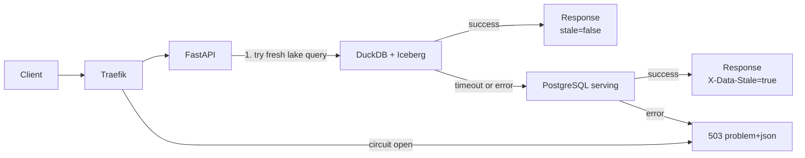

Rules:

- Try the fresh path first, with a hard timeout.
- Fall back to the serving path, and set `X-Data-Stale: true` plus `data_freshness_seconds`.
- If both fail, return 503 with a problem document and a `Retry-After` header.
- Emit a `bmip_api_fallback_total` metric and an alert when the fallback rate exceeds 5% for five minutes.
- Never return a cached value without marking it stale.

### 10.5 Why the API is the only query path

- It centralizes authentication, rate limiting, timeouts, and metrics.
- It prevents arbitrary heavy SQL from competing with ingestion for CPU.
- It makes the DuckDB single-writer rule irrelevant to readers.
- It gives the load balancer a clean unit to replicate.

For ad-hoc SQL by the team or the lecturer, a separate Jupyter container with read-only MinIO credentials is available in the `tools` profile. It is not part of the serving path.

## 11. Machine Learning and MLOps

### 11.1 Problem framing

| Item | Definition |
|---|---|
| Task | Regression, next-hour realized volatility |
| Entity | `BTCUSDT` (extensible to more symbols) |
| Frequency | Hourly |
| Feature window | `[T - 60m, T)` |
| Label | `rv_next_1h = std(log_return_1m)` over `(T, T + 1h]`, scaled by `sqrt(60)` if annualized values are preferred |
| Baseline 1 | Persistence: last hour's realized volatility |
| Baseline 2 | EWMA of realized volatility, lambda 0.94 |
| Primary metric | MAE |
| Secondary metrics | RMSE, R-squared, Spearman correlation |
| Validation | Chronological split and walk-forward folds; no shuffling |
| Success | Lower MAE than both baselines on the holdout window, with a stable margin across folds |

The model is deliberately small. The project is graded on the pipeline, the lineage, the reproducibility, the retraining loop, and the honesty of the evaluation, not on a state-of-the-art score.

### 11.2 Feature set

| Group | Feature | Source | Window |
|---|---|---|---|
| Returns | `ret_5m`, `ret_15m`, `ret_60m` | `silver.market_ohlcv_1m` | Trailing |
| Volatility | `rv_5m`, `rv_15m`, `rv_60m` | `silver.market_features_1m` | Trailing |
| Liquidity | `volume_z_60m`, `trade_count_60m`, `vwap_dev` | `silver.market_features_1m` | 60 minutes |
| Range | `hl_range_1m` | `silver.market_ohlcv_1m` | 1 minute |
| Sentiment | `sent_mean_1h`, `sent_pos_share`, `sent_neg_share` | `gold.mart_sentiment` | Previous hour |
| Attention | `post_count_1h`, `engagement_1h` | `gold.mart_sentiment` | Previous hour |

Feature versioning: `features/v1` is immutable. Adding or changing a feature creates `features/v2`, a new Feast feature view, and a new training run. A model records the feature version it used.

### 11.3 Feature store

Feast provides the offline store for training and the online store for inference.

| Setting | Value |
|---|---|
| Project | `bmip` |
| Entity | `symbol` |
| Offline source | Parquet in `s3://lakehouse/gold/features/` and Iceberg tables |
| Online store | PostgreSQL `postgres-ml`, schema `feast` |
| Registry | `s3://artifacts/feast/registry.db` or a mounted volume |
| Feature views | `market_features_1m` (TTL 1 hour), `sentiment_1h` (TTL 2 hours), `market_hourly` (TTL 2 hours) |
| Materialization | After `publish_serving`, hourly |
| Point-in-time join | `get_historical_features(entity_df, feature_refs)` |

Why Feast instead of hand-written joins: the point-in-time join is the mechanism that prevents leakage, and the same feature definitions serve training and inference. A hand-written join is easy to get wrong and hard to prove correct.

Offline-only is also acceptable per the brief. The online store is included because it makes the inference path realistic and costs one schema in an existing PostgreSQL instance.

### 11.4 Training pipeline

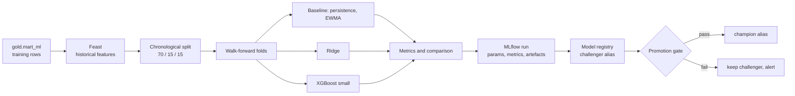

Steps:

1. Read the training window from `gold.mart_ml` at a recorded Iceberg snapshot.
2. Validate the dataset: no nulls in required features, no duplicate `(symbol, window_start)`, label window after feature window, minimum row count.
3. Split chronologically: 70% train, 15% validation, 15% test. Then run five expanding-window walk-forward folds inside the training portion.
4. Fit the baselines first. They are the number to beat.
5. Fit Ridge with standardization. Fit XGBoost with a small, fixed grid. Do not tune on the test set.
6. Log params, metrics, feature list, dataset snapshot ID, git SHA, and artefacts to MLflow.
7. Register the model as `challenger`.
8. Evaluate the promotion gate on the most recent seven days.
9. Promote or keep. Write the decision and the reason to `serving.model_decisions`.

Training is CPU-only and should finish in under five minutes on N2.

### 11.5 Models and hyperparameters

| Model | Configuration | Why |
|---|---|---|
| Persistence | `y_hat = rv_60m` | Hard baseline; if the model cannot beat this, it has no value |
| EWMA | `lambda=0.94` | Captures volatility clustering cheaply |
| Ridge | `alpha` in `{0.1, 1, 10}`, standardized features | Linear, interpretable, fast, robust with few samples |
| XGBoost | `max_depth=3`, `n_estimators=200`, `learning_rate=0.05`, `subsample=0.8`, `colsample_bytree=0.8`, `reg_lambda=1.0` | Captures non-linearity without overfitting a small dataset |

The final model is chosen by validation MAE, not by preference.

### 11.6 Experiment tracking and registry

| Item | Setting |
|---|---|
| Tracking URI | `http://mlflow:5000` |
| Backend store | `postgres-ml`, database `mlflow` |
| Artifact store | `s3://artifacts/mlflow/` |
| Experiment | `volatility` |
| Run tags | `git_sha`, `data_snapshot_id`, `feature_version`, `trigger` |
| Registered model | `volatility_model` |
| Aliases | `champion`, `challenger`, `archived` |
| Model signature | Input schema and output schema logged with the model |
| Model card | Markdown artefact attached to the version |

Aliases are used instead of stages. Stages are deprecated in modern MLflow; aliases are explicit and easy to query from the inference job.

### 11.7 Retraining and promotion

| Trigger | Condition | Action |
|---|---|---|
| Schedule | Every Sunday at 02:00 UTC | Train a challenger |
| Drift | PSI above 0.2 on any top-five feature, or rolling MAE degradation above 20% | Train a challenger within 24 hours |
| Manual | `make train MODEL=volatility` | Train a challenger for an experiment |
| Data milestone | A new month of gold data is complete | Train a challenger and compare |

Promotion gate:

1. The challenger passes all critical DQ checks on its training data.
2. The challenger's MAE on the last seven days is at least 5% lower than the champion's.
3. The challenger's RMSE is not worse than the champion's by more than 5%.
4. The leakage test passes.
5. The model card is complete.

If all conditions hold, the `champion` alias moves to the challenger and the previous champion becomes `archived`. If not, the challenger remains registered with a note. A failed promotion is a valid outcome and is shown in the dashboard.

### 11.8 Inference

| Mode | Frequency | Input | Output |
|---|---|---|---|
| Batch | Hourly at minute 05 | Latest online features from Feast | `gold.predictions`, `serving.predictions` |
| On demand | API request | Cached latest features | Response only, not persisted |

The inference job:

1. Loads the model by alias `champion` from the MLflow registry.
2. Fetches the latest feature vector for the symbol from the Feast online store.
3. Validates the feature vector against the model signature.
4. Predicts and computes a simple interval (for example, plus or minus one training RMSE).
5. Writes the prediction, model version, feature timestamp, and freshness to the serving table.
6. Emits `bmip_inference_total`, `bmip_prediction_value`, and `bmip_feature_age_seconds`.

If the model cannot be loaded or the features are older than two hours, the job fails, alerts, and does not write a stale prediction.

### 11.9 Drift and performance monitoring

| Signal | Method | Threshold | Action |
|---|---|---|---|
| Feature drift | Population Stability Index per feature, 10 bins | PSI > 0.2 | Warn and schedule retraining |
| Distribution shift | Kolmogorov-Smirnov test | p < 0.01 | Warn |
| Prediction drift | PSI of predicted values | PSI > 0.2 | Warn |
| Performance | Rolling MAE over the last seven days versus the champion's validation MAE | +20% | Critical alert |
| Freshness | Age of the latest feature and prediction | > 2 hours | Critical alert |

Drift reports are written to `serving.drift_metrics` and rendered in Grafana. Evidently is optional; the core PSI and KS calculations are small enough to implement and test directly, which keeps the dependency footprint low.

### 11.10 Sentiment model

**Phase 1, lexicon.** VADER produces a compound score in `[-1, 1]` for each post. It requires no training, is deterministic, and unblocks the pipeline in week one. The model version is recorded as `vader-3.3.2`.

**Phase 2, trained classifier.** If time permits:

- Text cleaning: lowercase, remove URLs, normalize mentions and hashtags, keep emoji signals.
- Vectorizer: TF-IDF, word 1-2 grams, `max_features=20,000`, `min_df=2`.
- Classifier: Logistic Regression, `C=1.0`, `class_weight=balanced`.
- Training data: a labeled public sentiment dataset with a clear license, plus an optional manually labeled sample of crypto posts.
- Metrics: macro-F1 and per-class recall. Accuracy is secondary.
- Tracking: MLflow experiment `sentiment`, registered model `sentiment_model`.
- Promotion: macro-F1 improvement of at least 3 points over VADER on the same labeled sample, and no class with recall below 0.5.

The sentiment model is a feature producer, not the primary deliverable. If phase 2 slips, phase 1 remains valid and documented.

### 11.11 Reproducibility and model card

Every model version records:

- Git commit SHA and a clean working tree flag.
- Iceberg snapshot ID of `gold.mart_ml`.
- Feature version and Feast registry version.
- Hyperparameters and random seed.
- Python and package lock file hash.
- Training row count, date range, and label definition.
- Metrics per fold and on the holdout.
- The exact command to reproduce the run.

The model card contains: intended use, out-of-scope use, training data description, features, metrics, limitations, ethical considerations, and the statement that this is not financial advice.

### 11.12 Limitations

- The sentiment history is short at the start. The first model may be trained on a few hundred hourly rows.
- Social sentiment is noisy and possibly weakly related to volatility. A negative result is reported, not hidden.
- The model is trained on one exchange and one symbol. It is not a general market model.
- Public posts are not a representative sample of all traders.
- No causal claim is made. The platform measures association and predictive value, not causation.

---

## 12. Orchestration

### 12.1 Prefect topology

| Component | Node | Purpose |
|---|---|---|
| Prefect server | N2 | API, UI, scheduler, run metadata |
| PostgreSQL ML | N2 | Prefect backend database |
| Work pool `local-process` | N2 | Executes Python flows in the worker container |
| Prefect worker | N2 | Polls the work pool and runs deployments |
| Blocks | N2 | Secret blocks for MinIO, PostgreSQL, API keys |
| Automations | N2 | Failure notifications, drift-triggered retraining |

Prefect 3 is used as a library and a server, not as a SaaS. All state stays in `postgres-ml`.

### 12.2 Flows

| Flow | Schedule | Retries | Timeout | Purpose |
|---|---|---|---|---|
| `harvest_social` | Hourly at :10 | 3, exponential | 20 min | Fetch, validate, write bronze, advance watermark |
| `build_silver_social` | Hourly at :40, or triggered | 2 | 15 min | Clean, deduplicate, pseudonymize, score sentiment |
| `build_gold` | Hourly at :50 | 2 | 20 min | Run dbt marts, publish serving tables |
| `publish_serving` | Hourly at :55 | 2 | 10 min | Upsert PostgreSQL serving tables and indexes |
| `run_dq` | After each layer | 1 | 10 min | Run GX suites and write results |
| `refresh_feast` | Hourly at :58 | 2 | 10 min | Materialize online features |
| `infer_volatility` | Hourly at :05 | 3 | 10 min | Load champion, predict, write predictions |
| `train_volatility` | Sunday 02:00, or drift trigger | 1 | 30 min | Train, evaluate, register challenger |
| `train_sentiment` | Weekly, manual | 1 | 30 min | Train and evaluate the sentiment classifier |
| `drift_report` | Daily 03:00 | 2 | 15 min | Compute PSI, KS, rolling MAE |
| `compact_iceberg` | Daily 01:00 | 2 | 30 min | Rewrite small files, expire snapshots |
| `backup_postgres` | Daily 02:30 | 2 | 20 min | Dump databases to MinIO |
| `replay_market` | Manual | 0 | 60 min | Replay a date and hour |
| `backfill_social` | Manual | 0 | 120 min | Backfill a date range |
| `health_report` | Every 15 min | 1 | 5 min | Freshness, lag, disk, certificate expiry |

### 12.3 Orchestration DAG

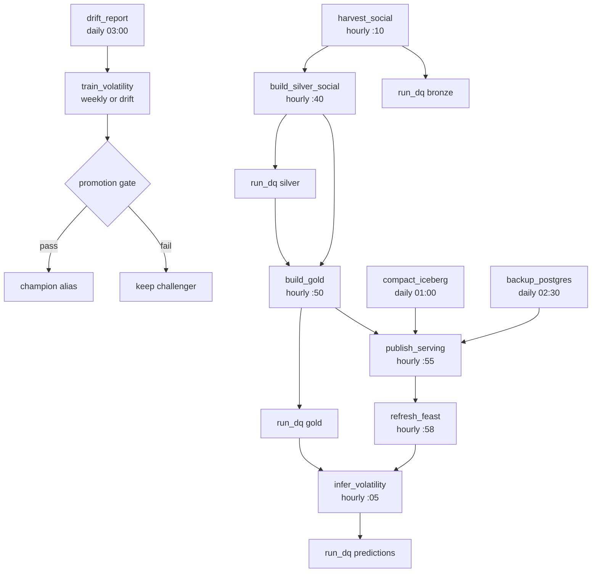

### 12.4 Backfill and rerun

```bash
# Backfill one day of social data
prefect deployment run "backfill_social/prod" \
  --param from_date=2026-11-01 --param to_date=2026-11-01

# Replay one hour of market data
prefect deployment run "replay_market/prod" \
  --param date=2026-11-10 --param hour=14

# Rebuild one layer
prefect deployment run "build_gold/prod" --param full_refresh=true
```

Every flow accepts a `dry_run` parameter. Every write is idempotent, so a rerun is safe. A rerun never deletes data outside its declared partition.

### 12.5 Error handling and notifications

- Retries use exponential backoff with jitter.
- A failed flow emits a Prefect event and sends a Telegram message with the flow name, run ID, error, and a runbook link.
- A failed critical DQ suite blocks downstream flows. Prefect marks the downstream run as `NotReady` rather than running on bad data.
- A failed harvest does not advance the watermark. The next run retries the same window.
- A failed model promotion does not change the champion. The previous champion continues to serve.
- A failed compaction does not block ingestion; it alerts and retries the next day.
- Every failure is recorded in `ops.pipeline_runs` with a correlation ID.

### 12.6 Concurrency and locking

| Resource | Limit | Reason |
|---|---|---|
| Work pool `local-process` | 2 concurrent flows | Protect the 16 GB node |
| `trainer` | 1 | Memory and CPU |
| `dbt` | 1 | DuckDB writer |
| `gx` | 1 per suite | Avoid connection storms |
| Iceberg table writer | 1 per table | Commit correctness |
| API replicas | 2 | Availability demo |

Prefect concurrency limits and a small PostgreSQL advisory lock implement the table lock. The lock is acquired by the writer and released after the commit. A second writer fails fast with a clear error instead of blocking indefinitely.

## 13. Data Quality

### 13.1 Quality dimensions

| Dimension | Question | Example rule |
|---|---|---|
| Completeness | Are required records and fields present? | Every hour has 60 one-minute bars |
| Uniqueness | Is each business event represented once? | `(symbol, trade_id)` is unique |
| Validity | Does the data satisfy its contract and domain rules? | `low <= open, close <= high` |
| Timeliness | Is the data fresh enough for its use? | Silver market data is under two minutes old |
| Consistency | Do related datasets agree? | Every prediction has a matching feature row |
| Accuracy | Does the data reflect the source? | Row count reconciliation against the source manifest |
| Integrity | Are relationships and constraints preserved? | Model version exists in the registry |

### 13.2 Great Expectations architecture

```text
gx/
  great_expectations.yml
  datasources/
    lakehouse.yml          # DuckDB + Iceberg/Parquet
    serving.yml            # PostgreSQL read replica or read-only role
  suites/
    bronze_social.yml
    bronze_market.yml
    silver_social.yml
    silver_market.yml
    gold_market.yml
    gold_sentiment.yml
    gold_ml.yml
    serving.yml
  checkpoints/
    bronze.yml
    silver.yml
    gold.yml
    serving.yml
  actions/
    update_data_docs.py    # upload HTML to s3://docs/gx/
    write_results.py       # insert into serving.dq_results
```

Execution model:

- GX runs as an ephemeral Prefect job, not an always-on service. It reads Iceberg through DuckDB and writes results to PostgreSQL.
- Each suite has a severity map. A critical failure fails the checkpoint; a warning failure records the result and continues.
- Data Docs are rendered to HTML and uploaded to `s3://docs/gx/<suite>/<run_ts>/index.html`. Traefik serves them under `https://docs.bmip.local/gx/`.
- Results are also written to `serving.dq_results` for the dashboard and alerts.

### 13.3 Rule catalog

**Bronze social**

| Rule | Severity | Action |
|---|---|---|
| `post_uri` is not null and unique | Critical | Quarantine duplicates, fail the batch |
| `created_at` is not null and not in the future | Critical | Quarantine, fail the batch |
| `text` length between 1 and 2,000 | Critical | Quarantine |
| Duplicate rate under 1% | Warning | Continue, alert |
| Row count greater than zero | Critical | Fail the flow |
| `lang` is a valid code or null | Warning | Continue |

**Bronze market**

| Rule | Severity | Action |
|---|---|---|
| `trade_id` is not null | Critical | Quarantine |
| `(symbol, trade_id)` is unique | Critical | Deduplicate, then assert |
| `price > 0` and `qty > 0` | Critical | Quarantine |
| `event_ts` is not in the future | Critical | Quarantine |
| `symbol` is in the allowlist | Critical | Reject |
| `event_ts` is monotonic per symbol | Warning | Reorder or quarantine |
| No gap longer than five minutes | Warning | Schedule a gap fill |

**Silver social**

| Rule | Severity | Action |
|---|---|---|
| `post_key` is unique | Critical | Block gold |
| No raw `post_uri`, `author_handle`, `display_name`, or `avatar`; only `post_key` | Critical | Block gold |
| `sentiment_score` between -1 and 1 | Critical | Block gold |
| `sentiment_model_version` is present | Warning | Alert |
| `created_at` within the last 30 days for live partitions | Warning | Alert |

**Silver market**

| Rule | Severity | Action |
|---|---|---|
| `low <= open`, `low <= close`, `close <= high` | Critical | Block gold |
| `(symbol, window_start)` is unique | Critical | Block gold |
| `volume >= 0` and `trade_count >= 0` | Critical | Block gold |
| Every expected minute is present for the last hour | Critical | Block gold, trigger replay |
| Feature null rate under 0.1% | Warning | Alert |
| Late event rate under 2% | Warning | Alert |

**Gold**

| Rule | Severity | Action |
|---|---|---|
| No gap in the hourly series for the last 24 hours | Critical | Block serving |
| `label_start > feature_window_end` | Critical | Block training |
| Every prediction has a matching feature row | Critical | Block serving |
| `mart_market` freshness under 90 minutes | Critical | Alert |
| `model_version` exists in the registry | Critical | Block serving |
| Row count within the expected range for the hour | Warning | Alert |

**Serving**

| Rule | Severity | Action |
|---|---|---|
| Primary keys are unique | Critical | Abort publish |
| Freshness under the endpoint SLO | Critical | Alert, set `stale=true` |
| No orphan prediction rows | Critical | Abort publish |
| Read-only role cannot write | Critical | Security test |

### 13.4 Severity and gates

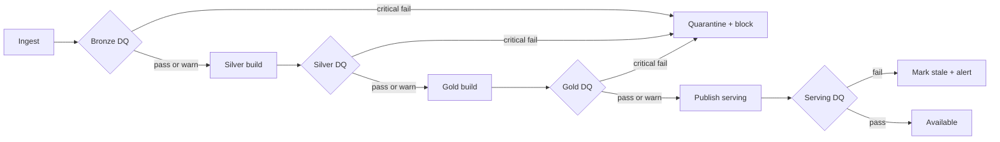

A critical failure stops promotion but does not delete data. The bad records stay in quarantine, and the pipeline can be replayed after the cause is fixed. Warnings are visible in the dashboard and the alert channel but do not block.

### 13.5 Quarantine and remediation

| Failure | Quarantine location | Remediation |
|---|---|---|
| Schema violation | `s3://quarantine/{social,market}/.../reason=schema/` | Fix the parser or contract, replay the batch |
| Late beyond window | `.../reason=late/` | Backfill the affected hour |
| Duplicate | Not quarantined; deduplicated | Verify the unique rule and row count |
| Impossible OHLC | `.../reason=ohlc/` | Inspect source, replay the minute |
| PII field present | Block the batch | Fix the transform, rebuild silver |
| Model feature missing | No quarantine; block prediction | Refresh Feast, rerun inference |

Every quarantine record has `reason`, `source`, `event_ts`, `ingest_ts`, `payload_hash`, and `raw_ref`. The quarantine index is queryable in the catalog portal.

### 13.6 Quality metrics and reporting

| Metric | Description |
|---|---|
| `bmip_dq_pass_rate{suite}` | Passing expectations divided by total expectations |
| `bmip_dq_failures_total{suite, rule, severity}` | Counter of failures |
| `bmip_dq_rows_checked{suite}` | Rows evaluated |
| `bmip_dq_runtime_seconds{suite}` | Suite duration |
| `bmip_quarantine_rows_total{source, reason}` | Quarantined rows |

Grafana shows pass rate, failures by rule, freshness, and quarantine volume. A daily quality report is generated as Markdown and uploaded to `s3://docs/reports/dq-YYYY-MM-DD.md`.

### 13.7 CI and test data

- Unit tests cover each expectation with a small fixture that should pass and one that should fail.
- Contract tests validate sample payloads against the JSON Schema.
- Integration tests start the data services, ingest a fixture, and assert bronze, silver, and gold row counts.
- A leakage test builds two synthetic hours and asserts that no feature uses data after its window.
- A duplicate test injects the same trade and post twice and asserts unchanged counts.
- A late test injects an event two minutes behind the watermark and asserts a corrected window.

---

## 14. Data Catalog and Lineage

### 14.1 Metadata model

The catalog has two sources of truth:

1. **Technical metadata and runtime lineage:** Marquez, fed by OpenLineage events.
2. **Business metadata:** `governance.dataset_registry` in PostgreSQL Core, maintained by the team and rendered by the catalog portal.

| Attribute | Example | Source |
|---|---|---|
| Name | `gold.mart_ml` | Registry |
| Description | "Hourly feature and label table for volatility training" | Registry |
| Domain | `market`, `social`, `ml`, `ops` | Registry |
| Owner | `ml-team` | Registry |
| Classification | `internal`, `confidential`, `pii` | Registry |
| License and source | `Binance public market data` | Registry |
| Retention | 90 days | Registry |
| SLA | Freshness under 90 minutes | Registry |
| Schema | Column names, types, descriptions | Iceberg plus dbt |
| Quality status | Last run, pass rate, failures | GX results |
| Lineage | Upstream and downstream datasets | Marquez |
| Version | Contract version and snapshot | Registry plus Iceberg |
| Location | `s3://lakehouse/warehouse/gold.db/mart_ml` | Iceberg |
| Sample | Masked sample rows | Portal |

### 14.2 OpenLineage integration

Every job emits a `START`, `RUNNING` (optional), and `COMPLETE` or `FAIL` event:

| Emitter | Method | Facets |
|---|---|---|
| Prefect tasks | Decorator wrapper around `@task` | `nominalTime`, `runId`, `parentRunId` |
| dbt | `dbt-ol` wrapper | `dbt_node`, `sql`, `model` |
| Great Expectations | Checkpoint action | `dataQuality`, `assertions` |
| Stream processor | Custom emitter | `kafka`, `partition`, `offset`, `watermark` |
| Publish serving | Custom emitter | `postgres`, `table`, `rowCount` |
| Inference | Custom emitter | `mlflow`, `modelVersion`, `featureVersion` |

Namespace convention: `bmip_batch`, `bmip_stream`, `bmip_ml`, `bmip_serving`. Dataset naming: `s3://lakehouse/warehouse/<layer>.db/<table>` and `postgres://serving/<table>`.

Marquez stores jobs, runs, datasets, and lineage edges. It does not store business ownership; the portal joins Marquez data with the registry.

### 14.3 Catalog portal

A Streamlit app with five views:

1. **Search:** full-text search over name, description, tags, owner, and column names. Filters for domain, classification, and layer.
2. **Dataset detail:** description, owner, schema, sample, quality status, retention, license, upstream and downstream links, and the last ten runs.
3. **Lineage graph:** an interactive graph from source to dashboard, with dataset and job nodes. Clicking a node opens its detail.
4. **Quality:** pass rate, failing rules, recent runs, quarantine volume, and links to GX Data Docs.
5. **Governance:** ownership gaps, missing descriptions, missing classifications, datasets past retention, and access requests.

Search implementation: PostgreSQL `tsvector` plus `pg_trgm` for fuzzy matching. The registry is small, so this is sufficient and avoids adding a search cluster.

### 14.4 Lineage capture points

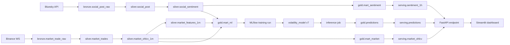

The graph answers the key grading question: "This number on the dashboard, which data produced it, which job transformed it, and which model scored it?"

### 14.5 Governance workflow

| Action | Steps | Approval |
|---|---|---|
| Register a dataset | Add a registry row, description, owner, classification, retention, license; run the metadata test | Data owner |
| Change a schema | Bump the contract version, update the registry, add a migration note, run compatibility tests | Data owner plus consumer |
| Deprecate a dataset | Mark `deprecated`, set a removal date, notify consumers, update the catalog | Data owner |
| Delete a dataset | Verify retention and legal hold, remove from the registry, expire Iceberg snapshots | Data owner plus platform owner |
| Grant access | Create a role or policy, record the request, review within one week | Platform owner |

---

## 15. Visualization and Dashboards

### 15.1 Streamlit pages

| Page | Content | Data source |
|---|---|---|
| Overview | Latest price, hourly volatility, sentiment score, next-hour prediction, freshness badges | `/v1/market/latest`, `/v1/predictions/latest`, `/v1/sentiment/timeseries` |
| Market | Candlestick chart, volume, realized volatility, returns, drawdown | `/v1/market/ohlcv`, `/v1/market/volatility` |
| Sentiment | Post volume, sentiment distribution, top hashtags, sentiment versus volatility | `/v1/sentiment/timeseries`, `/v1/sentiment/topics` |
| Predictions | Predicted versus actual, error over time, model version, drift indicators | `/v1/predictions/history`, `/v1/models/{name}/metrics` |
| Data quality | Pass rate, failures by rule, freshness, quarantine volume | `/v1/dq/results` |
| Catalog and lineage | Search, dataset detail, lineage graph, owner, license | `/v1/catalog/search`, `/v1/lineage/{dataset}` |

Design standards:

- Every panel shows the data timestamp and a freshness badge: green under SLO, amber within two times SLO, red beyond.
- Every chart shows the timezone (UTC) and the sample size.
- Predictions always show the model version and the evaluation window.
- No dual-axis chart without a clear label; no truncated axis that exaggerates volatility.
- A stale response is visibly marked; the dashboard never hides the `X-Data-Stale` header.
- The dashboard reads only the API, never the database directly. This keeps authorization and caching in one place.

### 15.2 Grafana dashboards

| Dashboard | Panels |
|---|---|
| Platform health | Container up, CPU, memory, restarts, disk usage, Tailscale reachability |
| Pipeline | Redpanda lag, produce and consume rate, Prefect run success and duration, dbt duration, GX runtime |
| Data SLO | Market and social freshness, completeness, DQ pass rate, quarantine rows |
| ML | Inference runs, prediction count, model version, rolling MAE, PSI, feature age |
| API and gateway | Request rate, p50/p95/p99 latency, 5xx rate, fallback rate, circuit breaker state, replica distribution |
| Alerts | Active alerts, firing history, acknowledgement, links to runbooks |

Grafana is provisioned as code. Dashboards live in `deploy/grafana/dashboards/*.json` and are loaded at startup. Manual edits in the UI are not the source of truth.

### 15.3 Access and performance

- Streamlit and Grafana are behind Traefik and Tailscale, with basic auth or SSO.
- Streamlit caches API responses for 30-60 seconds per page. It does not re-query on every widget interaction.
- Grafana queries Prometheus and PostgreSQL directly for operational panels; it does not go through the API for metrics.
- Both UIs are read-only for analysts. Admin actions happen in Prefect, MLflow, or the catalog portal.

### 15.4 Evidence

For each dashboard, the evidence pack contains:

- A screenshot with a timestamp.
- The provisioned JSON or the page source.
- The query or endpoint used for each panel.
- A short description of what the panel proves.

## 16. Alerting and Observability

### 16.1 Signals

| Signal | Source | Retention | Purpose |
|---|---|---|---|
| Metrics | Prometheus, cAdvisor, exporters, application `/metrics` | 15 days | Health, SLOs, alerting |
| Logs | Structured JSON to stdout, Promtail to Loki | 14 days | Debugging, audit |
| Lineage events | OpenLineage to Marquez | 90 days | Provenance |
| Run history | Prefect and MLflow | 90 days | Reproducibility |
| DQ results | PostgreSQL and GX Data Docs | 90 days | Trust |
| Traces | Not implemented in phase 1 | Not applicable | Future work |

Traces are deliberately out of scope. With four nodes and a handful of services, request IDs plus structured logs plus Prometheus histograms answer the operational questions without the cost of a tracing backend.

### 16.2 Prometheus targets

| Target | Endpoint | Node |
|---|---|---|
| cAdvisor | `:8080/metrics` | each |
| FastAPI replica 1 | `:8000/metrics` | N1 |
| FastAPI replica 2 | `:8000/metrics` | N2 |
| Traefik | `:8082/metrics` | N1 |
| Redpanda | `:9644/metrics` | N1 |
| MinIO | `:9000/minio/v2/metrics/cluster` | N1 |
| PostgreSQL Core | `postgres-exporter:9187` | N4 |
| Pushgateway | `:9091/metrics` | N4 |
| Grafana | `:3000/metrics` | N4 |
| Loki | `:3100/metrics` | N4 |

Batch jobs push their final metrics to Pushgateway: rows written, duration, last success timestamp, model MAE, DQ pass rate. Prefect failure hooks push `bmip_flow_failures_total` and the last-run timestamp. The custom `bmip_*` metrics are part of the application contract, not an assumption about a vendor exporter.

cAdvisor runs inside Docker Desktop's Linux VM, so it reports container metrics, not Windows host processes. Host-level Windows metrics are out of scope; disk pressure is measured through MinIO, which is the resource that matters for this platform.

Prometheus targets on another node use the Tailscale `100.x` address, not a Docker DNS name. Docker DNS resolves only within a single Compose project.

### 16.3 Alert rules

| Alert | Expression, simplified | For | Severity | Runbook |
|---|---|---|---|---|
| `MarketStreamLagHigh` | `max(redpanda_kafka_consumer_group_lag) > 5000` | 5m | Warning | `runbooks/stream-lag.md` |
| `MarketStreamLagCritical` | `max(redpanda_kafka_consumer_group_lag) > 50000` | 10m | Critical | `runbooks/stream-lag.md` |
| `MarketDataStale` | `time() - bmip_market_last_event_ts > 300` | 5m | Warning | `runbooks/market-stale.md` |
| `MarketDataStaleCritical` | `time() - bmip_market_last_event_ts > 900` | 5m | Critical | `runbooks/market-stale.md` |
| `SocialHarvestFailed` | `increase(bmip_flow_failures_total{flow="harvest_social"}[2h]) >= 2` | 5m | Critical | `runbooks/social-harvest.md` |
| `DQCriticalFailure` | `bmip_dq_failures_total{severity="critical"} > 0` | 1m | Critical | `runbooks/dq-failure.md` |
| `ModelDriftDetected` | `bmip_feature_psi > 0.2` | 30m | Warning | `runbooks/model-drift.md` |
| `ModelPerformanceDegraded` | `bmip_rolling_mae > 1.2 * bmip_champion_validation_mae` | 1h | Critical | `runbooks/model-drift.md` |
| `APIErrorRateHigh` | `sum(rate(http_requests_total{status=~"5.."}[5m])) / sum(rate(http_requests_total[5m])) > 0.05` | 5m | Critical | `runbooks/api-errors.md` |
| `APILatencyHigh` | `histogram_quantile(0.95, rate(http_request_duration_seconds_bucket[5m])) > 2` | 10m | Warning | `runbooks/api-latency.md` |
| `APIFallbackRateHigh` | `rate(bmip_api_fallback_total[5m]) / rate(http_requests_total[5m]) > 0.05` | 5m | Warning | `runbooks/api-fallback.md` |
| `CircuitBreakerOpen` | `sum(rate(traefik_service_requests_total{code="503"}[1m])) > 0.5` | 1m | Critical | `runbooks/circuit-breaker.md` |
| `DiskPressure` | `minio_disk_storage_available_bytes / minio_disk_storage_total_bytes < 0.2` | 10m | Warning | `runbooks/disk-pressure.md` |
| `ContainerRestartLoop` | `changes(container_start_time_seconds{name=~".+"}[15m]) > 3` | 5m | Critical | `runbooks/restart-loop.md` |
| `BackupFailed` | `time() - bmip_last_backup_success_ts > 129600` | 1h | Warning | `runbooks/backup.md` |
| `CertificateExpiry` | `bmip_tls_cert_expiry_seconds < 1209600` | 1h | Warning | `runbooks/tls.md` |

The first three rules are mandatory for the brief's "three alert rules" requirement. The rest make the platform operational rather than demonstrative.

### 16.4 Routing and escalation

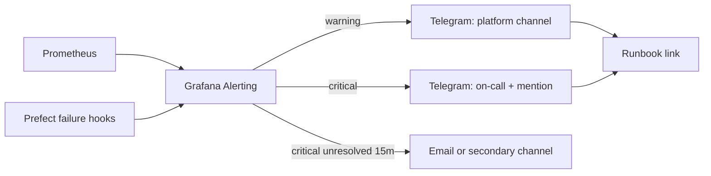

- Grafana unified alerting is the single router. Alertmanager is not deployed.
- Every alert has `severity`, `summary`, `description`, `runbook_url`, and `dashboard_url` labels.
- Alerts are grouped by service to prevent a restart storm from producing fifty messages.
- Silences are allowed only with an expiry and a reason.
- A resolved notification is sent for every firing notification.

### 16.5 Runbooks

| Runbook | First checks | Recovery |
|---|---|---|
| `stream-lag.md` | Producer health, consumer logs, Redpanda disk, network | Restart consumer, scale partitions, replay |
| `market-stale.md` | Binance reachability, DNS, producer logs, topic offsets | Reconnect, gap fill, replay |
| `social-harvest.md` | Bluesky status, rate limit, watermark, Prefect logs | Backoff, rerun, backfill |
| `dq-failure.md` | GX result, quarantined samples, upstream schema | Fix parser, replay, re-run suite |
| `model-drift.md` | PSI by feature, rolling MAE, data volume | Retrain, compare, promote or keep |
| `api-errors.md` | 5xx by route, DuckDB errors, PostgreSQL health | Fallback, restart replica, fix query |
| `api-fallback.md` | MinIO, Lakekeeper, DuckDB timeouts | Restore storage, restart API, verify freshness |
| `circuit-breaker.md` | Replica health, latency, error ratio | Remove fault, wait for recovery, verify |
| `disk-pressure.md` | MinIO usage, largest prefixes, retention job | Expire snapshots, compact, delete old backfills |
| `restart-loop.md` | Exit code, OOM kill, dependency health | Raise limit, fix config, roll back |
| `backup.md` | Last success, dump size, MinIO write | Re-run, verify restore |
| `tls.md` | Certificate dates, hostnames | Renew with mkcert or Tailscale |

### 16.6 SLOs

| SLO | Target | Measurement |
|---|---|---|
| Market freshness | 99% of minutes under 2 minutes | `bmip_market_freshness_seconds` |
| Social freshness | 99% of hours under 90 minutes | `bmip_social_freshness_seconds` |
| API availability | 99% during the demo window | Successful responses (2xx and 4xx) divided by all requests; 5xx counts against availability |
| API latency | 95% under the endpoint SLO | Histogram |
| Critical DQ | 100% pass before gold | GX results |
| Inference success | 99% of hourly runs | `bmip_inference_total` |
| Backup success | 100% of daily runs | Pushgateway |

The demo window is the only availability claim. The platform does not claim 99.9% uptime, because it has not been operated for a month.

### 16.7 Log schema

```json
{
  "ts": "2026-11-10T14:05:12.412Z",
  "level": "INFO",
  "service": "stream-processor",
  "node": "n1",
  "run_id": "01J...",
  "request_id": "req-...",
  "dataset": "silver.market_ohlcv_1m",
  "event": "iceberg_commit",
  "duration_ms": 184,
  "rows": 60,
  "error": null
}
```

Rules:

- Logs are JSON lines on stdout, collected by Docker and shipped by Promtail.
- Loki labels are low-cardinality: `service`, `node`, `level`. Do not label by `request_id`.
- Secrets and raw post text are never logged. A post is referenced by `post_key` and `raw_ref`; the raw URI stays in bronze.
- Every API response includes `X-Request-ID`; the same ID appears in the API log and in the upstream job log.

### 16.8 Dashboards as code

- Prometheus rules: `deploy/prometheus/alerts.yml`.
- Grafana provisioning: `deploy/grafana/provisioning/`.
- Dashboards: JSON files in `deploy/grafana/dashboards/`.
- CI validates the YAML and JSON, and a unit test checks that every alert has a runbook file.

---

## 17. Security

### 17.1 Threat model

| Threat | Example | Control |
|---|---|---|
| Spoofing | A laptop outside the tailnet calls the API | Tailscale identity plus API key; TLS; no public ports |
| Tampering | A job overwrites gold with bad data | Iceberg ACID, RBAC, DQ gate, signed commits, audit log |
| Repudiation | Nobody knows who ran a backfill | Prefect run history, OpenLineage, request IDs |
| Information disclosure | Raw post text or PII leaks to a dashboard | Pseudonymization, column allowlist, access control, no raw text in UI |
| Denial of service | A heavy query saturates DuckDB | Query caps, timeouts, rate limit, resource limits, circuit breaker |
| Elevation of privilege | A dashboard container reaches PostgreSQL as superuser | Per-service roles, internal networks, no superuser, read-only API |
| Supply chain | A compromised image tag | Pinned digests, Trivy scan, minimal images, no `latest` |
| Accidental exposure | MinIO bucket is public | Bucket policy tests, no anonymous access except the docs prefix |

### 17.2 Trust boundaries

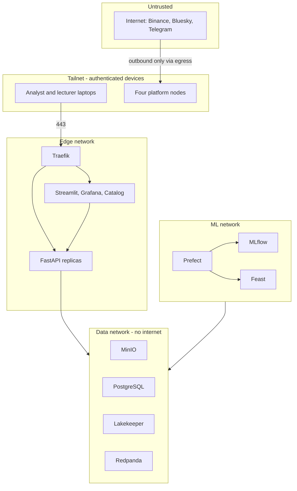

Boundaries:

- The internet can only be reached from the `egress` network by the producer, harvester, Prefect worker, and Grafana.
- The data network has no internet route.
- Only Traefik is reachable from the tailnet on 443. Service ports are reachable only from the specific peers listed in the ACL.
- Docker socket is never mounted into a user-facing container.

### 17.3 Identity and access

**Human roles:**

| Role | Tailscale tag | Access |
|---|---|---|
| Analyst | `tag:bmip-user` | Streamlit, catalog, read-only API |
| Data engineer | `tag:bmip-core` | Prefect, MLflow, MinIO console, catalog, database read/write |
| ML engineer | `tag:bmip-core` | MLflow, Feast, Prefect, read-only lake |
| Platform admin | `tag:bmip-core` | All, plus node shell and Docker |
| Lecturer or guest | `tag:bmip-user` | Dashboards and catalog only |

**Service identities:**

| Service | MinIO policy | PostgreSQL role | API scope |
|---|---|---|---|
| `market-producer` | write `bronze/market/*` | none | none |
| `social-harvester` | write `bronze/social/*`, `quarantine/social/*` | watermark read/write | none |
| `stream-processor` | read `bronze/*`, write `silver/market/*` | none | none |
| `dbt` | read `silver/*`, write `gold/*` | serving read/write | none |
| `gx` | read `silver/*`, `gold/*` | DQ results write | none |
| `mlflow` | read/write `artifacts/*` | MLflow database | none |
| `feast` | read `gold/*` | Feast schema read/write | none |
| `api` | read `gold/*`, `artifacts/*` | serving read-only | read-only |
| `streamlit` | none | none | API read |
| `prometheus` | read metrics only | exporter read-only | none |

Rules:

- No application uses the MinIO root user or the PostgreSQL superuser.
- The API key table stores hashes, not plaintext keys.
- A service account can only do the one job it is named for.
- Access is reviewed at the end of the project; demo credentials are rotated.

### 17.4 Secrets management

| Secret | Storage | Rotation |
|---|---|---|
| MinIO root | Docker secret, bootstrap only | After demo |
| MinIO service keys | Docker secrets or SOPS | 30 days |
| PostgreSQL passwords | Docker secrets or SOPS | 30 days |
| API keys | Hashed in PostgreSQL; plaintext only to the owner | 30 days |
| MLflow and Prefect credentials | Docker secrets | 30 days |
| Telegram bot token | Docker secret | After demo |
| mkcert CA key | Local, never committed | Not applicable |

Rules:

- `.env` is gitignored. `.env.example` contains placeholders only.
- `gitleaks` runs in pre-commit and CI.
- Secrets are never printed in logs, error messages, or the catalog.
- The demo uses separate credentials from development.

### 17.5 Encryption

| Path | Control |
|---|---|
| User to Traefik | TLS 1.3 with a local CA certificate; HSTS |
| Node to node | Tailscale WireGuard |
| Container to container on the same host | Docker bridge; documented as a trusted boundary |
| API to MinIO | HTTP inside the data network; optional TLS if a certificate is added |
| API to PostgreSQL | Internal network; TLS optional |
| At rest on disk | BitLocker on the Windows volume |
| At rest in MinIO | SSE-S3 with a local key stored as a Docker secret |
| Backups | Encrypted by MinIO SSE-S3; optional age encryption |

The document is explicit about what is and is not encrypted. Claiming end-to-end encryption while using plain HTTP inside the Docker network would be dishonest.

### 17.6 PII and privacy

- The author DID is pseudonymized with `HMAC-SHA256(salt, did)`. The salt is a Docker secret.
- The post URI contains the author DID, so silver stores only `post_key = HMAC-SHA256(salt, post_uri)` and never the raw URI. Bronze is the only layer with the raw URI, under restricted access.
- Handle, display name, avatar, and profile data are dropped at the silver boundary.
- Post text is retained for sentiment, but it is internal-only and never shown raw in the demo or the catalog sample.
- The retention for raw social data is 14 days; silver is 30 days.
- A deletion request is honored by mapping the raw URI to `post_key` and deleting the row from bronze and silver on the next run. Aggregates may retain the effect until the next rebuild; this limitation is documented.
- No private messages, protected accounts, or non-public data are collected.
- The legal basis is academic research on public data. The report includes the source, license, and limitations.

### 17.7 API security

- API key in `X-API-Key`; keys are random 32-byte values, stored as Argon2 hashes, and shown once.
- Rate limit at Traefik and in the application.
- Input validation with Pydantic: symbol allowlist, date range caps, limit caps, enum validation.
- Parameterized queries. Table and column names come from an allowlist, never from user input.
- Response size cap.
- Security headers: `X-Content-Type-Options`, `X-Frame-Options`, `Referrer-Policy`, `Content-Security-Policy` for the UIs.
- CORS disabled unless a specific origin is allowlisted.
- Errors do not reveal stack traces or SQL.

### 17.8 Audit logging

| Event | Where | Retention |
|---|---|---|
| API request | Traefik access log plus FastAPI log | 14 days |
| Authentication failure | FastAPI log | 14 days |
| Backfill and replay | Prefect run history | 90 days |
| Data write | OpenLineage event | 90 days |
| Schema change | Catalog registry | Permanent |
| Access change | Registry audit table | Permanent |
| Secret rotation | Runbook log | Permanent |

### 17.9 Supply chain and container hardening

- Images are pinned by digest.
- Images are scanned with Trivy; no critical vulnerability is accepted without a documented exception.
- Containers run as non-root where the image supports it.
- `no-new-privileges` and dropped capabilities where possible.
- Read-only root filesystem for the API, Streamlit, and portal.
- No Docker socket mount in application containers.
- Dependency locks are committed; `pip-audit` or `uv audit` runs in CI.

### 17.10 Security test checklist

| Test | Expected result | Evidence |
|---|---|---|
| Port scan from outside the tailnet | Only 443 on N1 reachable from a tailnet device; nothing from the internet | `evidence/security/port-scan.txt` |
| Unauthenticated API call | 401 | `evidence/security/api-401.txt` |
| Expired or revoked key | 401 | `evidence/security/api-revoked.txt` |
| Rate limit | 429 after the configured burst | `evidence/security/rate-limit.txt` |
| MinIO ingest policy | Cannot read `silver/*` | `evidence/security/minio-policy.txt` |
| PostgreSQL API role | Cannot insert or update | `evidence/security/pg-role.txt` |
| PII scan | No handle or display name in silver | `evidence/security/pii-scan.txt` |
| Secret scan | No finding | `evidence/security/gitleaks.txt` |
| Image scan | No critical CVE | `evidence/security/trivy.txt` |
| TLS | Valid certificate and HSTS | `evidence/security/tls.txt` |
| Audit log | The test request appears with a request ID | `evidence/security/audit.txt` |

## 18. Governance

### 18.1 Ownership and RACI

| Workstream | Owner | Responsible for | Accountable |
|---|---|---|---|
| Platform and operations | P1 | Compose, Tailscale, Traefik, MinIO, PostgreSQL, Redpanda, security, backup, benchmark | P1 |
| Data engineering | P2 | Ingesters, stream processor, Iceberg, dbt, DQ, Prefect flows | P2 |
| ML and MLOps | P3 | Feast, training, MLflow, inference, drift, model cards | P3 |
| Analytics and governance | P4 | Catalog, lineage, Streamlit, Grafana, documentation, evidence, demo | P4 |
| API and integration | P2 and P3 | Contract, endpoints, fallback, tests | P2 |
| Security review | P1 and P4 | Threat model, access review, secret scan, PII scan | P1 |
| Demo | All | Script, rehearsal, evidence pack | P4 |

RACI for cross-cutting decisions:

| Decision | Responsible | Accountable | Consulted | Informed |
|---|---|---|---|---|
| Schema change | Data engineer | Data owner | API and ML consumers | All |
| New service | Platform owner | Platform owner | Team | All |
| Model promotion | ML engineer | ML owner | Data engineer | All |
| Access grant | Platform owner | Platform owner | Data owner | Requester |
| Scope cut | Team lead | Team lead | All | Lecturer |

### 18.2 Data classification

| Class | Examples | Handling |
|---|---|---|
| Public | Aggregated market metrics, published dashboards | Can be shown in the demo and report |
| Internal | Silver and gold tables, feature vectors, model metrics | Tailnet only, authenticated |
| Confidential | Raw post text, API keys, credentials, backups | Restricted roles, encrypted, never in the demo |
| PII | Author DID, handle, display name | Hashed or dropped at silver; never exposed |

### 18.3 Policies

| Policy | Rule | Enforcement |
|---|---|---|
| Retention | Bronze 14 days, silver 30 days, gold 90 days, logs 14 days | Lifecycle job and Iceberg snapshot expiry |
| Access | Least privilege, one role per service, quarterly review | MinIO policies, PostgreSQL roles, Tailscale ACL |
| Quality | Critical rules block promotion; warnings alert | GX checkpoints and Prefect gates |
| Change | Contract version bump, ADR for architecture changes, PR review | Git, CI, catalog changelog |
| Incident | S1 platform down, S2 data stale, S3 degraded | Runbooks and alert severity |
| Deprecation | Announce, set a removal date, notify consumers, keep a read-only copy for 30 days | Catalog workflow |
| Deletion | Honor source deletion and retention; record the action | Deletion job and audit log |
| Backup | Daily database dump, versioned object storage, tested restore | Prefect backup flow and restore drill |

### 18.4 Metadata and naming standards

| Object | Convention | Example |
|---|---|---|
| Iceberg namespace | Lowercase layer | `silver` |
| Table | `<domain>_<entity>` | `market_ohlcv_1m` |
| Column | `snake_case`; `_ts` for timestamps, `_at` for event labels, `is_` for booleans | `window_start`, `created_at`, `is_buyer_maker` |
| Flow | `<verb>_<object>` | `harvest_social`, `build_gold` |
| Topic | `<domain>.<entity>.<qualifier>` | `market.trades.raw` |
| Bucket prefix | Lowercase, slash-separated | `bronze/social/...` |
| Contract | `<entity>.v<major>.json` | `social_post.v1.json` |
| Model | `<target>_model` | `volatility_model` |
| Alert | `PascalCase` | `MarketDataStale` |
| Dashboard | `kebab-case` | `platform-health` |

Every table has a description, an owner, a domain, a classification, a retention period, and a license. A metadata test in CI fails if a new table is missing any of these.

### 18.5 Licensing and provenance

The report and the catalog record:

- Source name and URL.
- Retrieval method and date.
- License or terms of use, with the access date.
- Whether the data contains personal data.
- Known limitations and bias.
- Whether redistribution is allowed.

Summary:

| Source | License or terms | Redistribution |
|---|---|---|
| Bluesky public posts | Public AT Protocol data; Bluesky ToS has no scraping prohibition | No raw text redistribution; aggregates only |
| Binance market data | Public market data; `data.binance.vision` official dataset | No standalone redistribution; derived metrics allowed |
| Labeled sentiment dataset (phase 2) | Checked at selection time; recorded in the model card | Depends on the dataset license |

### 18.6 Audit and compliance evidence

The evidence pack contains:

- This architecture document.
- ADRs.
- Data contracts and their changelog.
- DQ rule catalog and results.
- Access matrix and ACL export.
- Secret scan and image scan results.
- Backup and restore log.
- Lineage screenshots.
- Model cards.
- Benchmark results.
- Demo script and recording.

### 18.7 Resource and cost governance

There is no cloud bill, but there is a resource budget. The platform is governed by the same discipline:

- Every always-on service has a memory limit and a named owner.
- Heavy jobs are ephemeral and serialized.
- Retention is enforced automatically; disk pressure is an alert, not a surprise.
- A service that cannot justify its resource cost is removed. This is why DataHub, Trino, Spark, Superset, Keycloak, and Vault are not in the stack.

---

## 19. API Gateway and Resilience

### 19.1 Capability mapping

| Capability | Implementation | Demonstrated by | Status |
|---|---|---|---|
| Reverse proxy | Traefik routers and entrypoints | One TLS hostname for API, dashboards, and console | Implemented |
| API gateway | Traefik middlewares: auth, rate limit, retry, headers, CORS | 401 without a key, 429 after the burst | Implemented |
| Load balancing | Traefik `loadBalancer` with two FastAPI servers | 20 requests split across two replicas | Implemented |
| Health check | Docker liveness plus Traefik readiness | Stop a replica; it leaves the pool | Implemented |
| Circuit breaker | Traefik `circuitBreaker` middleware | Toxiproxy latency opens the circuit; recovery closes it | Implemented |
| Service discovery | Docker provider intra-node; `services.yaml` and Tailscale IPs inter-node | Add a replica; Traefik discovers it | Implemented, configuration-based |
| Consul or etcd discovery | Not deployed | Not applicable | Rejected as unnecessary for four nodes |

### 19.2 Traefik configuration

Static configuration:

```yaml
entryPoints:
  web:
    address: ":80"
    http:
      redirections:
        entryPoint:
          to: websecure
          scheme: https
  websecure:
    address: ":443"
  metrics:
    address: ":8082"

providers:
  docker:
    exposedByDefault: false
    network: edge
  file:
    directory: /etc/traefik/dynamic
    watch: true

metrics:
  prometheus:
    entryPoint: metrics
    addEntryPointsLabels: true
    addServicesLabels: true

accessLog:
  format: json
```

Dynamic configuration, simplified:

```yaml
tls:
  certificates:
    - certFile: /etc/traefik/certs/bmip.pem
      keyFile: /etc/traefik/certs/bmip-key.pem

http:
  routers:
    api:
      rule: "Host(`api.bmip.local`)"
      entryPoints: [websecure]
      tls: {}
      service: api
      middlewares: [api-rate-limit, api-retry, api-circuit-breaker, api-headers]
    app:
      rule: "Host(`app.bmip.local`)"
      entryPoints: [websecure]
      tls: {}
      service: streamlit
      middlewares: [ui-auth, ui-headers]

  services:
    api:
      loadBalancer:
        strategy: wrr
        healthCheck:
          path: /health/ready
          interval: 10s
          timeout: 3s
        servers:
          - url: "http://100.64.0.11:8000"
          - url: "http://100.64.0.12:8000"
    streamlit:
      loadBalancer:
        servers:
          - url: "http://100.64.0.13:8501"

  middlewares:
    api-rate-limit:
      rateLimit:
        average: 100
        burst: 200
    api-retry:
      retry:
        attempts: 3
        initialInterval: 200ms
    api-circuit-breaker:
      circuitBreaker:
        expression: "ResponseCodeRatio(500,600,0,600) > 0.25 || LatencyAtQuantileMS(50.0) > 1500"
        checkPeriod: 10s
        fallbackDuration: 30s
        recoveryDuration: 30s
        responseCode: 503
    api-headers:
      headers:
        contentTypeNosniff: true
        frameDeny: true
        referrerPolicy: strict-origin-when-cross-origin
    ui-auth:
      basicAuth:
        usersFile: /etc/traefik/users.htpasswd
```

Notes:

- Traefik OSS supports the circuit breaker middleware, active health checks, retries, rate limits, and weighted round-robin.
- Circuit breaker and rate limit are **not** applied to Streamlit. Streamlit uses long-lived WebSockets; an HTTP circuit breaker can terminate sessions and a rate limit can break asset loading.
- Basic auth is the default for UIs. Dex and oauth2-proxy are an optional upgrade if SSO is needed.
- API authentication is enforced in FastAPI, not in Traefik, because API keys need per-consumer revocation and audit.

### 19.3 Load balancing test

```bash
for i in $(seq 1 20); do
  curl -s -H "X-API-Key: $BMIP_API_KEY" \
    https://api.bmip.local/v1/meta/instance
done | sort | uniq -c
```

Expected output: approximately ten requests to `api-1` and ten to `api-2`. Then stop `api-2` and repeat: all requests go to `api-1`, with no 5xx. The Grafana panel `API and gateway` shows the replica distribution.

### 19.4 Health checks

| Check | Endpoint | Used by | Checks |
|---|---|---|---|
| Liveness | `/health/live` | Docker | Process is running and the event loop responds |
| Readiness | `/health/ready` | Docker and Traefik | At least one query path is usable: the lake path (MinIO plus Lakekeeper) or the serving path (PostgreSQL). The body reports each path; 503 only when both fail |
| Metrics | `/metrics` | Prometheus | Exposes counters and histograms |
| Streamlit | `/_stcore/health` | Docker and Traefik | Streamlit server responds |
| Prefect | `/api/health` | Docker | API and database |
| MinIO | `/minio/health/live` | Docker | Object store |
| Lakekeeper | `/health` | Docker | Catalog and database |
| Redpanda | `rpk cluster health` | Docker | Broker and partitions |

Readiness must be meaningful. A process that is alive but cannot serve either the lake path or the serving path is not ready, and Traefik should stop sending it traffic. A process that can serve from PostgreSQL while MinIO is down is still ready, with `stale=true` in the response.

### 19.5 Circuit breaker and fallback

The circuit breaker protects the query tier from a failing or slow dependency and prevents request pile-up.

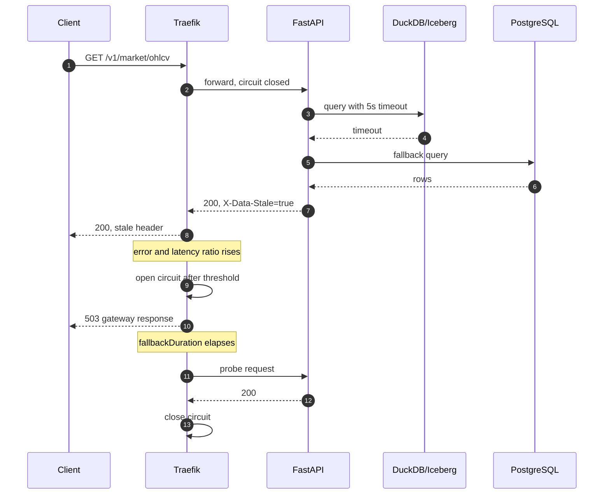

Rules:

- The application fallback handles a single slow dependency.
- The gateway circuit breaker handles a failing replica or a total API failure.
- The gateway's 503 is a gateway response; the application returns RFC 7807 `problem+json` before the circuit opens.
- The circuit breaker does not create capacity. It fails fast and protects the rest of the system.
- A sustained 503 burst from Traefik fires `CircuitBreakerOpen`. The access log and the runbook distinguish a tripped circuit from an unrelated upstream failure.
- The runbook explains how to confirm the fault, remove it, and verify recovery.

### 19.6 Service discovery

| Scope | Mechanism | Why |
|---|---|---|
| Container to container on one node | Docker Compose DNS and service names | Built in, zero cost |
| Traefik to containers on one node | Traefik Docker provider with labels | Automatic on restart |
| Traefik to replicas on other nodes | Static `servers` list from `services.yaml` | Four nodes do not justify Consul |
| Human access | Tailscale MagicDNS or hosts-file names | Stable and readable |
| Node addressing | Tailscale `100.x` addresses | Stable across networks |

The `services.yaml` file is the single source of truth:

```yaml
nodes:
  n1: 100.64.0.11
  n2: 100.64.0.12
  n3: 100.64.0.13
  n4: 100.64.0.14
services:
  api:
    replicas:
      - http://100.64.0.11:8000
      - http://100.64.0.12:8000
  minio: http://100.64.0.11:9000
  lakekeeper: http://100.64.0.11:8181
  marquez: http://100.64.0.13:5002
```

A generator renders the Traefik servers list and the `.env` files from this file. This is configuration-based discovery: simple, inspectable, and sufficient. Consul would add a service, a failure mode, and 200-400 MB for no benefit at this scale.

### 19.7 Failure scenarios

| Scenario | Expected behaviour | User impact | Recovery |
|---|---|---|---|
| One API replica stops | Traefik health check removes it; traffic goes to the survivor | None | Restart the replica |
| One API replica is slow | Health check or circuit breaker removes it | Brief 503 for some requests | Restart or fix the replica |
| DuckDB or MinIO fails | API falls back to PostgreSQL; `X-Data-Stale: true` | Stale data, clearly marked | Restore MinIO or Lakekeeper |
| PostgreSQL fails | API uses DuckDB/Iceberg | Fresh but slower queries | Restart PostgreSQL |
| Both data paths fail | Circuit opens; 503 problem document | API unavailable | Restore dependencies |
| Stream processor stops | Offsets retained; replay on restart | Market data delayed | Restart the processor |
| Producer stops | Redpanda retains seven days | Market data stops | Restart or switch to replay |
| N2 fails | Orchestration and ML stop; N1 continues | No new predictions; dashboards still read | Restart N2 or run flows on N1 |
| N3 fails | Catalog and dashboards fail; pipeline continues | UI unavailable | Restart N3 |
| N4 fails | Observability lost; pipeline continues | No alerts | Restart N4 |
| N1 fails | Data plane and primary API fail | Platform unavailable | Restore N1; RTO about 30 minutes |
| Disk full | MinIO writes fail; alerts fire | Ingestion stops | Expire snapshots, delete old data |

### 19.8 What is not claimed

- **No high availability.** Two API replicas provide availability of the query tier, not of the data tier. MinIO, PostgreSQL, and Redpanda are single instances.
- **No automatic failover.** A node loss requires manual recovery, documented with an RTO.
- **No horizontal scalability claim.** The broker has three partitions to allow a second consumer, but this was not benchmarked at scale.
- **No zero-downtime deployment.** A restart of a single replica is invisible; a restart of the data node is not.
- **No public exposure.** The tailnet is the security boundary, and the demo does not use the public internet.

## 20. Testing and Evidence Plan

### 20.1 Test pyramid

| Level | Scope | Tools | When | Blocking |
|---|---|---|---|---|
| Unit | Parsers, windowing, feature math, dedupe, DQ expectations | pytest, pydantic | Every commit | Yes |
| Contract | JSON Schema and API schema compatibility | jsonschema, schemathesis | Every commit | Yes |
| Integration | Compose profile with MinIO, PostgreSQL, Lakekeeper, Redpanda | pytest, Docker Compose | Every pull request | Yes |
| End-to-end | Source fixture to bronze, silver, gold, serving, API | pytest, HTTP client | Nightly and before demo | Yes |
| Non-functional | Replay, late data, fault injection, security, performance | Toxiproxy, k6 or Locust, curl, Trivy, gitleaks | Weekly and before demo | Yes for critical |
| Acceptance | The checklist mapped to `Spek.md` | Manual plus scripts | Before submission | Yes |

CI stages:

1. Lint and format: Ruff, Black, SQLFluff for dbt models, Markdown link check.
2. Unit and contract tests.
3. `docker compose config` validation for every profile.
4. Image build with pinned digests and a Trivy scan.
5. Integration tests on the dev profile.
6. Documentation build: dbt docs and GX Data Docs.
7. Nightly benchmark and failure injection on the four-node profile.

### 20.2 Automated test cases

| ID | Test | Method | Pass criterion | Evidence |
|---|---|---|---|---|
| T01 | Social contract accepts a valid post | Validate a fixture against `social_post.v1` | No error | `evidence/tests/T01.json` |
| T02 | Market contract rejects a negative price | Validate a malformed fixture | Validation error with field path | `evidence/tests/T02.json` |
| T03 | Social deduplication | Insert the same `post_uri` twice | Silver count unchanged | `evidence/tests/T03.txt` |
| T04 | Market deduplication | Publish the same `trade_id` twice | Silver count and volume unchanged | `evidence/tests/T04.txt` |
| T05 | Idempotent replay | Replay one hour twice, compare counts and hashes | Identical logical result | `evidence/replay/T05.txt` |
| T06 | Late event correction | Inject a trade two minutes late | The correct minute is updated | `evidence/tests/T06.txt` |
| T07 | Malformed quarantine | Publish invalid JSON | Record in quarantine with reason; metric increments | `evidence/tests/T07.txt` |
| T08 | OHLC correctness | Compare a known minute with a hand calculation | Exact match on open, high, low, close, volume | `evidence/tests/T08.txt` |
| T09 | No leakage | Build two synthetic hours; assert feature timestamps | All features at or before `window_start` | `evidence/tests/T09.txt` |
| T10 | Sentiment range | Score a fixture batch | Every score in `[-1, 1]` | `evidence/tests/T10.txt` |
| T11 | Critical DQ gate | Inject a null `trade_id` | Gold build is blocked; alert fires | `evidence/tests/T11.txt` |
| T12 | Warning DQ path | Inject a 2% duplicate rate | Pipeline continues; warning recorded | `evidence/tests/T12.txt` |
| T13 | API authentication | Call without a key | 401 problem document | `evidence/security/api-401.txt` |
| T14 | API pagination | Request 1,000 rows with limit 100 | Ten pages, no duplicates, stable cursor | `evidence/tests/T14.txt` |
| T15 | Stale fallback | Stop MinIO, request a range | 200 with `X-Data-Stale: true` | `evidence/tests/T15.txt` |
| T16 | Load balancing | Twenty requests to `/v1/meta/instance` | Both replicas observed | `evidence/tests/T16.txt` |
| T17 | Health removal | Stop `api-2` | No 5xx; one replica serves | `evidence/tests/T17.txt` |
| T18 | Circuit breaker | Add 2 s latency via Toxiproxy | Circuit opens; 503; recovers after removal | `evidence/tests/T18.txt` |
| T19 | Backup and restore | Dump, drop a schema, restore, query | Row counts match | `evidence/recovery/T19.txt` |
| T20 | Model reproducibility | Retrain from the same snapshot | Metrics within 1% tolerance | `evidence/ml/T20.txt` |
| T21 | Promotion gate | Register a worse challenger | Champion unchanged; decision recorded | `evidence/ml/T21.txt` |
| T22 | PII scan | Query silver columns and sample values | No handle, display name, or raw DID | `evidence/security/pii-scan.txt` |
| T23 | Lineage event | Run a dbt model | Marquez shows the upstream and downstream edge | `evidence/lineage/T23.png` |
| T24 | End-to-end freshness | Publish a trade and wait | Silver and gold within the SLO | `evidence/tests/T24.txt` |

### 20.3 Failure injection matrix

| Fault | Command, example | Expected | Recovery | Evidence |
|---|---|---|---|---|
| Kill the producer | `docker stop market-producer` | Ingestion stops; Redpanda retains; alert after 5 minutes | `docker start market-producer` | `evidence/faults/producer.txt` |
| Kill the stream processor | `docker stop stream-processor` | Lag grows; restart replays from offset | Start; verify duplicate-free | `evidence/faults/processor.txt` |
| Kill one API replica | `docker stop api-2` | Traefik removes it; no 5xx | Start; health returns | `evidence/faults/api-replica.txt` |
| Add 2 s API latency | Toxiproxy latency toxic | Circuit opens; alert; 503 | Remove toxic; recovery | `evidence/faults/circuit-breaker.txt` |
| Kill MinIO | `docker stop minio` | API falls back to PostgreSQL | Start; ready returns | `evidence/faults/minio.txt` |
| Kill PostgreSQL Core | `docker stop postgres-core` | API uses DuckDB; serving writes fail | Start; restore if needed | `evidence/faults/postgres.txt` |
| Corrupt one record | Publish a negative price | Quarantine; critical DQ alert; gold blocked | Fix and replay | `evidence/faults/dq.txt` |
| Fill the disk | Optional bounded test | MinIO write error; disk alert | Expire snapshots; clean | `evidence/faults/disk.txt` |
| Stop N2 | Shut down the laptop or stop Docker | N1 continues; predictions stale; alert | Restart; flows resume | `evidence/faults/n2.txt` |
| Clock skew | Shift a fixture timestamp | Late handling; warning | Normalize; replay | `evidence/faults/clock.txt` |

The disk test uses a disposable volume and a strict time limit. It must not endanger the demo data.

### 20.4 Benchmark plan

| Benchmark | Method | Target | Actual | Evidence |
|---|---|---|---|---|
| Producer throughput | Replay at 1,000 trades/s for 10 minutes | No loss; lag under 5 s | To be measured | `evidence/benchmark/ingest.csv` |
| End-to-end latency | Timestamp at producer and at silver commit | p95 under 120 s | To be measured | `evidence/benchmark/latency.csv` |
| API latest endpoint | 20 concurrent clients, 60 s | p95 under 300 ms | To be measured | `evidence/benchmark/api-latest.txt` |
| API range endpoint | 14-day OHLC query, 20 concurrent | p95 under 2 s | To be measured | `evidence/benchmark/api-range.txt` |
| Query cold cache | First query after restart | Under 5 s | To be measured | `evidence/benchmark/cold.txt` |
| DQ runtime | Full silver suite | Under 60 s | To be measured | `evidence/benchmark/dq.txt` |
| Training | Full volatility run on N2 | Under 5 minutes | To be measured | `evidence/benchmark/train.txt` |
| Inference | Hourly batch | Under 30 s | To be measured | `evidence/benchmark/inference.txt` |
| Resource usage | cAdvisor peak per node | Under the budget in Section 5.4 | To be measured | `evidence/benchmark/resources.csv` |
| Recovery time | Restart and node-loss drills | Container under 5 min; node under 30 min | To be measured | `evidence/recovery/rto.csv` |

The benchmark script is reproducible: `make benchmark`. It writes raw output, a summary, and the git SHA. A number without a command and a commit is not evidence.

### 20.5 Acceptance checklist

| # | Criterion | Pass condition | Evidence | Status |
|---|---|---|---|---|
| 1 | Two source types | Batch and stream both produce data | Ingestion logs, counts | Planned |
| 2 | Event timestamp and unique ID | Contracts and samples show both | Contract tests | Planned |
| 3 | Bronze, silver, gold | All three layers populated and cataloged | Catalog listing | Planned |
| 4 | Three marts | All three exist with documented schemas | dbt docs | Planned |
| 5 | Ten endpoints | OpenAPI lists at least ten data endpoints | `openapi.json` | Planned |
| 6 | One ML model | Champion trained from pipeline output | MLflow run | Planned |
| 7 | One dashboard | Streamlit reads serving layer | Screenshot | Planned |
| 8 | Rerun and replay | T05 and T06 pass | Test outputs | Planned |
| 9 | Recovery procedure | T17 to T19 pass | Fault logs | Planned |
| 10 | Metrics and logs | Prometheus and Loki show the pipeline | Dashboard screenshots | Planned |
| 11 | Three alerts | At least three rules fire and resolve | Telegram screenshots | Planned |
| 12 | Security checks | All Section 17.10 tests pass | Security evidence | Planned |
| 13 | Automated validation | CI is green | CI output | Planned |
| 14 | Docker Compose | All profiles validate and start | `compose config` | Planned |
| 15 | Benchmark | All targets measured and reported | Benchmark files | Planned |
| 16 | Documentation | This document plus install, contracts, evidence | Repository | Planned |
| 17 | Legal data | Sources and licenses recorded | Section 6.2, catalog | Planned |
| 18 | No managed cloud | All core services local | Compose files | Planned |
| 19 | No false HA claim | Section 19.8 present in the report | Report | Planned |
| 20 | One integrated use case | Sentiment and market join in `mart_ml` | Lineage graph | Planned |

Status changes to `Pass` only when the evidence file exists. The final report includes this table with links.

### 20.6 Evidence repository

```text
evidence/
  README.md                 # index, environment, commit SHA
  ingestion/                # counts, samples, lag
  replay/                   # before/after checksums
  recovery/                 # fault logs, RTO measurements
  security/                 # scans, auth tests, policy tests
  api/                      # OpenAPI, curl outputs
  ml/                       # MLflow exports, model cards, drift
  benchmark/                # raw CSV, summary, plots
  dashboards/               # screenshots with timestamps
  lineage/                  # Marquez screenshots
  tests/                    # test outputs by ID
```

Rules:

- Every file has a timestamp and the git SHA in its name or header.
- Screenshots show the system clock and the URL.
- Raw output is kept, not only a summary.
- The index maps each file to a checklist item.

### 20.7 Demo script, 15 minutes

| Time | Step | What it proves | Fallback |
|---|---|---|---|
| 0:00 | Show the architecture diagram and the node topology | Scope and environment | Slide |
| 1:30 | Catalog search for `mart_ml`, open lineage | Catalog, ownership, lineage | Screenshot |
| 3:30 | Show live market data arriving and the freshness badge | Streaming, medallion, serving | Replay mode |
| 5:30 | Run a DQ check with a deliberately bad record | Quality gate and quarantine | Pre-recorded output |
| 7:30 | Open MLflow, compare champion and challenger, show the gate | MLOps and honest evaluation | Saved runs |
| 9:30 | Open the prediction dashboard and the drift panel | Model in use, monitoring | Screenshot |
| 11:00 | Stop one API replica; show the load balancer | Health check and LB | Pre-recorded |
| 12:00 | Inject latency; show the circuit breaker and stale fallback | Resilience | Pre-recorded |
| 13:30 | Show the alert in Telegram and the runbook | Alerting and operations | Screenshot |
| 14:30 | State the limitations and the next steps | Honesty and scope | Slide |

The demo is rehearsed at least twice on the real four-node topology. A recorded backup exists for every live step.

## 21. Risks and Mitigations

| # | Risk | Likelihood | Impact | Mitigation | Trigger | Owner |
|---|---|---|---|---|---|---|
| R01 | Tailscale and Docker Desktop networking does not work as expected | Medium | High | Day-one spike; fallback to LAN static IPs; document firewall rules; test from a second laptop | Cross-node ping or port fails | P1 |
| R02 | Binance domains are DNS-blocked | High | Medium | DoH resolver, Tailscale DNS override, `BinanceVisionReplayFeed`; pre-download a demo window | Producer cannot connect | P2 |
| R03 | Bluesky API changes or rate-limits | Medium | Medium | Adapter isolation, backoff, local cache, static replay; collect early | 403 or 429 for three runs | P2 |
| R04 | DuckDB or PyIceberg limitation blocks a transformation | Medium | High | Week-one spike on partitioned overwrite; fallback to partition-level Parquet plus manifest; keep Iceberg for append-only tables | Write fails or is not idempotent | P1 and P2 |
| R05 | Two-to-four-week timeline slips | High | High | Weekly milestones; scope cuts in Section 22.5; phase 2 optional | Week 2 milestone missed | All |
| R06 | 16 GB nodes run out of memory | Medium | Medium | Limits, one heavy job at a time, dev profile, move a service | OOM kill or swap thrash | P1 |
| R07 | Windows bind mounts cause permission or line-ending issues | Medium | Low | Named volumes for data; LF via `.gitattributes`; config read-only | Container cannot read config | P1 |
| R08 | Sentiment history is too short for a meaningful model | High | Medium | Start harvesting immediately; gold 90 days; report the limitation; use market-only baseline | Fewer than 300 rows | P3 |
| R09 | The model does not beat the baseline | Medium | Medium | Honest evaluation is an accepted result; focus on the MLOps loop; report H0 | Holdout MAE worse | P3 |
| R10 | Single points of failure cause a demo outage | Medium | High | No HA claim; restart policies; recorded demo; spare laptop; RTO drill | N1 unavailable | P1 |
| R11 | Legal or PII concern about social data | Low | High | Public data only, pseudonymization, retention, no raw redistribution, document license | PII found in silver | P4 |
| R12 | Scope creep from extra resilience components | Medium | Medium | Timebox; mark Consul and Dex optional; core first | Week 3 without core ML | All |
| R13 | Secret leakage | Low | High | Gitignore, gitleaks, Docker secrets, rotation, least privilege | gitleaks finding | P1 |
| R14 | Demo network instability | Medium | High | Replay mode, local fixtures, recorded evidence, offline dashboards | Network drop during rehearsal | P4 |
| R15 | Data loss during compaction or retention | Low | High | Snapshot expiry only after retention; backup; dry run; table lock | Row count drop | P2 |

Risk review happens at the end of every week. A risk without an owner and a trigger is not managed.

## 22. Implementation Roadmap

### 22.1 Four-week plan

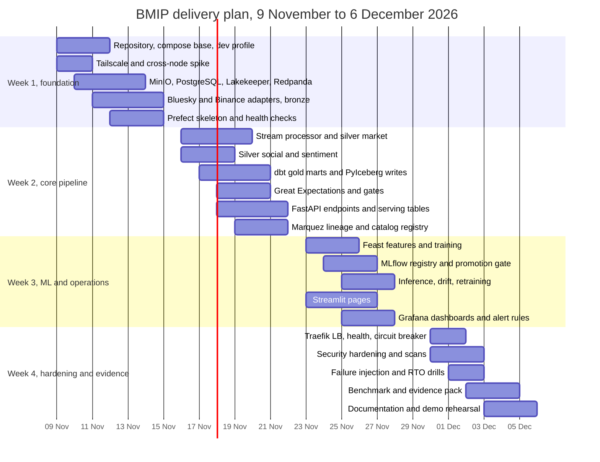

### 22.2 Phase deliverables

| Phase | Milestone | Deliverables | Exit criterion |
|---|---|---|---|
| Week 1 | M1, foundation | Repository, Compose base and dev profile, Tailscale working across two laptops, MinIO and Lakekeeper running, bronze social and market data, Prefect skeleton, health checks | A trade and a post land in bronze and are visible in MinIO |
| Week 2 | M2, medallion and serving | Stream processor, silver tables, three gold marts, GX suites, ten API endpoints, serving tables, Marquez lineage, catalog registry | End-to-end from source to API works on the dev profile |
| Week 3 | M3, ML and operations | Feast feature views, Ridge and XGBoost training, MLflow registry, champion and challenger, hourly inference, drift report, Streamlit pages, Grafana dashboards, alert rules | A prediction appears in the dashboard and an alert fires in Telegram |
| Week 4 | M4, hardening and evidence | Traefik LB, health checks, circuit breaker, security tests, failure injection, benchmark, evidence pack, final report, demo rehearsal | All Section 20.5 items are `Pass` or explicitly deferred with a reason |

### 22.3 Work split

| Person | Week 1 | Week 2 | Week 3 | Week 4 |
|---|---|---|---|---|
| P1, platform and operations | Compose base, Tailscale spike, MinIO, PostgreSQL, Lakekeeper, Redpanda | Serving PostgreSQL, backup, CI, observability foundation | Prometheus, Grafana provisioning, alert routing | Traefik resilience, security, benchmark, RTO drills |
| P2, data engineering | Bluesky and Binance adapters, bronze contracts, Prefect skeleton | Stream processor, silver market, dbt marts, GX, replay | Orchestration hardening, backfills, lineage events, API integration | Failure injection, data evidence, runbooks |
| P3, ML and MLOps | Feature definition, VADER baseline, experiment plan | Feature tables, Feast setup, training notebook to flow | MLflow registry, promotion gate, inference, drift, retraining | Model cards, reproducibility, ML evidence |
| P4, analytics and governance | Catalog metadata model, UI wireframes, documentation skeleton | Catalog portal, Marquez integration, Streamlit v1 | Streamlit pages, Grafana business panels, access model | Evidence pack, final document, demo script and rehearsal |

Shared work: API contract review, integration tests, code review, daily 15-minute sync. Every person writes tests for their own code and reviews one other person's pull request.

### 22.4 Definition of done

A work item is done when:

- The code is merged with a reviewed pull request.
- Unit and contract tests pass.
- The integration test on the dev profile passes.
- The change is visible in the catalog with an owner and a description.
- A runbook or README section explains how to operate it.
- The evidence file exists and is linked from the acceptance checklist.
- The demo path still works.

### 22.5 Scope cuts if the timeline is two weeks

If the team has two weeks instead of four, keep the core and defer the rest explicitly:

**Keep:**

- Bluesky and Binance ingestion, bronze, silver, three gold marts.
- Ten endpoints and one Streamlit dashboard.
- Great Expectations critical suites.
- Marquez lineage for the main path.
- One volatility model with MLflow tracking and hourly inference.
- Three alert rules and the core Grafana dashboard.
- Replay, one fault injection, and the evidence pack.
- Docker Compose on two nodes plus the dev profile.

**Defer:**

- The second API replica and the full circuit-breaker demo.
- Feast online store; use offline point-in-time joins only.
- The trained sentiment classifier; keep VADER.
- Loki, Dex, oauth2-proxy, Toxiproxy.
- Advanced catalog search and the governance workflow UI.
- The four-node profile; use two nodes and a spare.
- Weekly retraining automation; keep a manual retrain flow.
- The 90-day gold history; keep 30 days and document the limitation.

The deferred list is written in the final report. A smaller, complete platform is stronger than a large, unfinished one.

## 23. Appendices

### Appendix A. Repository layout

```text
bmip/
  README.md
  ARCHITECTURE.md
  Makefile
  pyproject.toml
  .env.example
  .gitignore
  .gitattributes
  contracts/
    social_post.v1.json
    market_trade.v1.json
    openapi.json
  deploy/
    compose.base.yml
    compose.dev.yml
    compose.node1.yml
    compose.node2.yml
    compose.node3.yml
    compose.node4.yml
    compose.jobs.yml
    compose.chaos.yml
    env/
    traefik/
    minio/
    postgres/
    prometheus/
    grafana/
  src/
    bmip/
      common/          # config, logging, metrics, contracts
      ingest/          # social harvester, market producer, adapters
      process/         # stream processor, silver transforms
      dbt/             # dbt project
      quality/         # GX suites, checkpoints, actions
      ml/              # features, training, inference, drift
      api/             # FastAPI app, routers, repositories
      dashboard/       # Streamlit pages
      catalog/         # catalog portal
      ops/             # backup, restore, replay, benchmark
  gx/
  docs/
    adr/
    runbooks/
    install.md
    demo.md
    data-contracts.md
  tests/
    unit/
    contract/
    integration/
    e2e/
  evidence/
  scripts/
```

Rules:

- `src/` contains application code only. No notebooks in the serving path.
- `deploy/` contains everything needed to start a node.
- `contracts/` is the source of truth for schemas.
- `tests/` mirrors `src/` so that a reviewer can find the test for a module.
- `evidence/` is generated, but the index and the summary are committed.

### Appendix B. Environment variables

| Variable | Example | Used by | Notes |
|---|---|---|---|
| `BMIP_ENV` | `dev`, `node1`, `demo` | all | Selects configuration |
| `BMIP_NODE` | `n1` | all | Node identity |
| `BMIP_LOG_LEVEL` | `INFO` | all | Log verbosity |
| `TAILSCALE_IP_N1` | `100.64.0.11` | all | Static peer address |
| `TAILSCALE_IP_N2` | `100.64.0.12` | all | Static peer address |
| `TAILSCALE_IP_N3` | `100.64.0.13` | all | Static peer address |
| `TAILSCALE_IP_N4` | `100.64.0.14` | all | Static peer address |
| `MINIO_ENDPOINT` | `http://100.64.0.11:9000` | ingest, process, dbt, ml, api | S3 endpoint |
| `MINIO_ACCESS_KEY` | from secret | services | Per-service key |
| `MINIO_SECRET_KEY` | from secret | services | Per-service secret |
| `LAKEKEEPER_URL` | `http://100.64.0.11:8181` | process, dbt, api | Iceberg REST catalog |
| `LAKEKEEPER_WAREHOUSE` | `lakehouse` | process, dbt | Warehouse name |
| `POSTGRES_CORE_DSN` | `postgresql://...` | api, dbt, backup | Serving and catalog |
| `POSTGRES_ML_DSN` | `postgresql://...` | prefect, mlflow, feast | ML metadata |
| `POSTGRES_GOV_DSN` | `postgresql://...` | marquez | Lineage metadata |
| `REDPANDA_BROKERS` | `redpanda:9092` | producer, processor | Internal broker address |
| `MARKET_SYMBOL` | `BTCUSDT` | producer, processor | Allowlist |
| `MARKET_FEED` | `binance_ws` | producer | `binance_ws`, `binance_vision`, `static` |
| `SOCIAL_FEED` | `bluesky` | harvester | `bluesky`, `static` |
| `SOCIAL_QUERY` | `bitcoin OR btc OR crypto` | harvester | Keyword set |
| `SOCIAL_MAX_PAGES` | `50` | harvester | Rate-limit guard |
| `BMIP_API_KEY_HASH_SALT` | from secret | api | API key hashing |
| `PII_HASH_SALT` | from secret | silver transform | DID pseudonymization |
| `MLFLOW_TRACKING_URI` | `http://mlflow:5000` | training, inference | Tracking |
| `MLFLOW_S3_ENDPOINT_URL` | `http://100.64.0.11:9000` | MLflow | Artifact store |
| `FEAST_REPO_PATH` | `/app/feature_repo` | feast, training, inference | Registry |
| `TELEGRAM_BOT_TOKEN` | from secret | Grafana, Prefect | Notifications |
| `TELEGRAM_CHAT_ID` | from secret | Grafana, Prefect | Destination |
| `TRAEFIK_DOMAIN` | `bmip.local` | Traefik | Base domain |
| `RETENTION_BRONZE_DAYS` | `14` | lifecycle job | Retention |
| `RETENTION_SILVER_DAYS` | `30` | lifecycle job | Retention |
| `RETENTION_GOLD_DAYS` | `90` | lifecycle job | Retention |

Secrets are not stored in `.env` in the demo. The table shows the variable names; the values come from Docker secrets or SOPS.

### Appendix C. Data contracts

The full JSON Schemas are in `contracts/`. The essential shape is below.

**`social_post.v1.json`, simplified:**

```json
{
  "$schema": "https://json-schema.org/draft/2020-12/schema",
  "$id": "https://bmip.local/contracts/social_post.v1.json",
  "title": "SocialPostV1",
  "type": "object",
  "required": ["post_uri", "author_did", "created_at", "text", "source", "schema_version", "raw_ref"],
  "properties": {
    "post_uri": { "type": "string", "minLength": 8, "maxLength": 512 },
    "author_did": { "type": "string", "minLength": 3 },
    "author_handle": { "type": ["string", "null"] },
    "created_at": { "type": "string", "format": "date-time" },
    "lang": { "type": ["string", "null"] },
    "text": { "type": "string", "minLength": 1, "maxLength": 2000 },
    "hashtags": { "type": "array", "items": { "type": "string" }, "maxItems": 20 },
    "like_count": { "type": "integer", "minimum": 0 },
    "repost_count": { "type": "integer", "minimum": 0 },
    "reply_count": { "type": "integer", "minimum": 0 },
    "quote_count": { "type": "integer", "minimum": 0 },
    "source": { "const": "bluesky" },
    "schema_version": { "const": "1.0" },
    "raw_ref": { "type": "string" }
  },
  "additionalProperties": false
}
```

**`market_trade.v1.json`, simplified:**

```json
{
  "$schema": "https://json-schema.org/draft/2020-12/schema",
  "$id": "https://bmip.local/contracts/market_trade.v1.json",
  "title": "MarketTradeV1",
  "type": "object",
  "required": ["symbol", "trade_id", "event_ts", "price", "qty", "is_buyer_maker", "ingest_ts", "source", "schema_version"],
  "properties": {
    "symbol": { "type": "string", "enum": ["BTCUSDT"] },
    "trade_id": { "type": "integer", "minimum": 1 },
    "event_ts": { "type": "string", "format": "date-time" },
    "price": { "type": "number", "exclusiveMinimum": 0 },
    "qty": { "type": "number", "exclusiveMinimum": 0 },
    "is_buyer_maker": { "type": "boolean" },
    "ingest_ts": { "type": "string", "format": "date-time" },
    "source": { "enum": ["binance_ws", "binance_vision", "binance_rest"] },
    "schema_version": { "const": "1.0" }
  },
  "additionalProperties": false
}
```

**API error, RFC 7807:**

```json
{
  "type": "https://bmip.local/problems/invalid-range",
  "title": "Invalid time range",
  "status": 400,
  "detail": "The requested range exceeds 31 days.",
  "instance": "/v1/market/ohlcv",
  "request_id": "req-01J..."
}
```

Contract change rules:

- Additive optional fields: minor version, no migration.
- New required field or type change: major version, migration plan, consumer sign-off.
- Removal: deprecation notice, dual-write period, removal date.

### Appendix D. Quality and alert quick reference

The authoritative tables are Section 13.3 and Section 16.3. The minimum set for the demo is:

| Type | Minimum set |
|---|---|
| Critical DQ | Unique trade ID, positive price, valid OHLC, unique post URI, no PII columns, no label leakage |
| Warning DQ | Duplicate rate, late rate, feature null rate, row-count range |
| Alerts | `MarketDataStale`, `MarketStreamLagHigh`, `DQCriticalFailure`, `APIErrorRateHigh`, `ModelPerformanceDegraded`, `DiskPressure` |
| Runbooks | One per alert, linked from the alert annotation |

### Appendix E. Implementation snippets

These snippets are illustrative. Exact library versions are pinned in `pyproject.toml` and verified in the week-one spike.

**PyIceberg partition overwrite:**

```python
from pyiceberg.catalog import load_catalog
from pyiceberg.expressions import EqualTo, And
import pyarrow as pa

catalog = load_catalog(
    "lakekeeper",
    type="rest",
    uri="http://100.64.0.11:8181",
    warehouse="lakehouse",
    **s3_properties,
)
table = catalog.load_table("silver.market_ohlcv_1m")

table.overwrite(
    arrow_table,
    overwrite_filter=And(
        EqualTo("symbol", "BTCUSDT"),
        EqualTo("window_start", window_start),
    ),
)
```

**DuckDB read over Iceberg:**

```sql
INSTALL iceberg;
LOAD iceberg;
INSTALL httpfs;
LOAD httpfs;

SET s3_endpoint = '100.64.0.11:9000';
SET s3_use_ssl = false;
SET s3_access_key_id = '...';
SET s3_secret_access_key = '...';

ATTACH 'lakehouse' AS lakehouse (
  TYPE iceberg,
  ENDPOINT 'http://100.64.0.11:8181',
  CLIENT_ID 'svc-api',
  CLIENT_SECRET '...'
);

SELECT symbol, window_start, close, realized_vol_1h
FROM lakehouse.gold.mart_market
WHERE symbol = 'BTCUSDT'
  AND window_start >= now() - INTERVAL 7 DAY
ORDER BY window_start;
```

**dbt model skeleton:**

```sql
{{ config(
    materialized='table',
    partition_by={'field': 'event_date', 'data_type': 'date'}
) }}

with hourly as (
    select
        symbol,
        date_trunc('hour', window_start) as window_start,
        first(open order by window_start) as open,
        max(high) as high,
        min(low) as low,
        last(close order by window_start) as close,
        sum(volume) as volume,
        sum(trade_count) as trade_count
    from {{ ref('stg_market_ohlcv_1m') }}
    group by 1, 2
)

select
    *,
    cast(window_start as date) as event_date,
    current_timestamp as updated_at
from hourly
```

**Compose service skeleton:**

```yaml
services:
  api-1:
    image: bmip/api:${GIT_SHA}
    restart: unless-stopped
    mem_limit: 700m
    cpus: 1.0
    env_file:
      - env/common.env
      - env/node1.env
    secrets:
      - postgres_core_password
      - minio_api_secret
    networks:
      - edge
      - data
    ports:
      - "8000:8000"
    healthcheck:
      test: ["CMD", "curl", "-fsS", "http://localhost:8000/health/live"]
      interval: 10s
      timeout: 3s
      retries: 3
      start_period: 20s
    logging:
      driver: json-file
      options:
        max-size: "10m"
        max-file: "3"
```

### Appendix F. Day-one spike checklist

Run this before writing application code. It decides whether the architecture is feasible on the actual laptops.

| # | Check | Pass condition | Fallback if it fails |
|---|---|---|---|
| 1 | Docker Desktop starts on all four laptops | `docker info` succeeds | Reinstall, enable WSL2, update Windows |
| 2 | Tailscale is up on all nodes | `tailscale status` shows all peers | Use a LAN with static addresses |
| 3 | Cross-node TCP works | `Test-NetConnection 100.64.0.12 -Port 8000` succeeds | Add firewall rule; check WSL mode |
| 4 | MinIO starts and is reachable from N2 | `mc alias set` and `mc ls` work | Use N1 only, reduce to two nodes |
| 5 | PostgreSQL starts and accepts remote connection | `psql` from N2 works | Co-locate API-2 with N1 for the demo |
| 6 | Lakekeeper starts and creates a warehouse | `curl /health` returns OK | Use a filesystem catalog for the spike, then retry |
| 7 | PyIceberg writes a test table | Commit succeeds; snapshot visible | Fall back to partitioned Parquet plus manifest; document |
| 8 | DuckDB reads the test table | Query returns rows | Read Parquet directly |
| 9 | Binance WebSocket connects | At least ten trades received | Use DoH, real IP, or `binance_vision` replay |
| 10 | Bluesky search returns posts | At least one page received | Use a cached fixture for the demo; retry later |
| 11 | Traefik routes to one API container | `curl -k https://api.bmip.local/health/live` works | Use path-based routing or direct ports |
| 12 | TLS certificate is trusted | Browser shows no warning | Install the mkcert CA or use HTTP inside the tailnet |
| 13 | Resource usage is within budget | All services under Section 5.4 | Reduce limits, drop optional services |
| 14 | One full trade reaches the API | End-to-end latency measured | Fix the stage that is slow |

The spike is timeboxed to two days. If items 3, 7, or 9 fail, the fallbacks are mandatory, not optional.

### Appendix G. Glossary

| Term | Meaning |
|---|---|
| Bronze | Raw, immutable landing layer; one object set per source and time partition |
| Silver | Cleaned, deduplicated, conformed, quality-gated layer |
| Gold | Business-level marts for analytics and ML |
| Lakehouse | Object storage plus an open table format with database-like semantics |
| Iceberg | Open table format with snapshots, ACID commits, and schema evolution |
| REST catalog | Catalog protocol used by Iceberg clients; Lakekeeper implements it |
| Watermark | Event-time progress marker used to decide when a window is complete |
| Event time | When the source produced the event |
| Ingest time | When the platform received the event |
| Idempotency | Re-running an operation produces the same logical result |
| Exactly-once, effectively | At-least-once delivery plus idempotent writes |
| DQ | Data quality |
| Lineage | The graph of datasets and jobs that produced a result |
| Feature store | A system that serves the same feature definitions to training and inference |
| Point-in-time join | A join that uses only feature values known before the label window |
| Champion | The model alias currently used for inference |
| Challenger | A newly trained model waiting for promotion |
| Drift | A change in input or output distribution that may degrade the model |
| PSI | Population Stability Index, a binned distribution-shift metric |
| RTO | Recovery time objective, the target time to restore service |
| SLO | Service level objective, a measurable reliability target |
| Tailnet | A Tailscale private network |
| Circuit breaker | A gateway pattern that stops sending traffic to a failing backend |
| Fallback | A secondary path used when the primary path fails |
| Medallion | The bronze, silver, gold layering pattern |
| Mart | A curated, query-ready table for a business domain |

### Appendix H. References

| Topic | Reference |
|---|---|
| Assignment specification | `Spek.md`, local project file |
| Reference architecture to improve on | `Referensi.md`, local project file |
| Bluesky search posts | https://docs.bsky.app/docs/api/app-bsky-feed-search-posts |
| Bluesky terms of service | https://bsky.social/about/support/tos |
| Binance WebSocket streams | https://developers.binance.com/docs/binance-spot-api-docs/web-socket-streams |
| Binance public data | https://data.binance.vision/ |
| Apache Iceberg | https://iceberg.apache.org/docs/latest/ |
| PyIceberg | https://py.iceberg.apache.org/ |
| Lakekeeper | https://docs.lakekeeper.io/ |
| DuckDB Iceberg extension | https://duckdb.org/docs/stable/core_extensions/iceberg/overview |
| dbt-duckdb | https://github.com/duckdb/dbt-duckdb |
| Redpanda | https://docs.redpanda.com/ |
| MinIO | https://min.io/docs/minio/linux/index.html |
| Prefect 3 | https://docs.prefect.io/ |
| Great Expectations | https://docs.greatexpectations.io/ |
| Marquez | https://marquezproject.ai/ |
| OpenLineage | https://openlineage.io/ |
| MLflow | https://mlflow.org/docs/latest/ |
| Feast | https://docs.feast.dev/ |
| Traefik circuit breaker | https://doc.traefik.io/traefik/middlewares/http/circuitbreaker/ |
| Traefik health checks | https://doc.traefik.io/traefik/routing/services/#health-check |
| Traefik rate limit | https://doc.traefik.io/traefik/middlewares/http/ratelimit/ |
| Tailscale Docker | https://tailscale.com/kb/1282/docker |
| Tailscale ACLs | https://tailscale.com/kb/1018/acls |
| mkcert | https://github.com/FiloSottile/mkcert |
| Toxiproxy | https://github.com/Shopify/toxiproxy |
| Prometheus | https://prometheus.io/docs/ |
| Grafana alerting | https://grafana.com/docs/grafana/latest/alerting/ |
| Streamlit | https://docs.streamlit.io/ |
| X API pricing, rejected alternative | https://developer.x.com/en/products/x-api |

All links were consulted during design in November 2026. Versions and terms must be re-checked at implementation time.

### Appendix I. Assumptions and open questions

| # | Assumption or question | Impact if wrong | Resolution |
|---|---|---|---|
| 1 | Four laptops are available for the demo | The four-node profile cannot be shown | Use the two-node profile and document it |
| 2 | The lecturer accepts DuckDB plus FastAPI as the \"light\" query option | A query-engine change may be requested | Cite the specification's explicit allowance; keep Iceberg so Trino could be added later |
| 3 | Bluesky remains publicly accessible without authentication | The batch source fails | Use stored fixtures and document the outage |
| 4 | Binance remains reachable through DoH or replay | The stream source fails | Use `data.binance.vision` and replay |
| 5 | PyIceberg and Lakekeeper versions are compatible | The write path needs rework | Pin versions and run the day-one spike |
| 6 | DuckDB can read the Iceberg tables without a write conflict | The API path needs a fallback | Read Parquet directly as a fallback |
| 7 | Telegram is available for alerts | Notifications fail | Use email or a local webhook receiver |
| 8 | A local CA can be installed on the demo clients | TLS warnings appear | Use Tailscale certificates or HTTP inside the tailnet |
| 9 | The data volume stays under the estimates | Disk pressure | Enforce retention and reduce the replay window |
| 10 | The model may not beat the baseline | A negative result | Report H0 honestly; the platform still meets the brief |
| 11 | The 90-day gold retention is acceptable despite the 7-14 day hot-retention preference | Storage grows | Reduce gold to 30 days and document the trade-off |
| 12 | The four-person team can work in parallel without blocking | Timeline slips | Weekly integration day and a shared API contract |

### Appendix J. Installation quick start

This is the minimum procedure to get from a fresh clone to a running development stack. The full version lives in `docs/install.md`; this appendix is the architecture-level contract for that document.

**Prerequisites, every laptop:**

- Windows 11 with WSL2 enabled.
- Docker Desktop 29.x with Compose v5.x. Start it before any command.
- Git, Python 3.12, and `make` (Git Bash or WSL).
- Tailscale, signed in to the project tailnet.
- `mkcert` for the local certificate authority.
- At least 40 GB free disk on N1; 20 GB on the other nodes.

**Single-laptop development:**

```bash
# 1. Verify Docker
docker info

# 2. Clone and configure
git clone <repository> bmip && cd bmip
cp .env.example .env
make secrets            # generates local secrets into .env and Docker secret files

# 3. Start the dev profile
make dev-up

# 4. Wait for health, then bootstrap storage and catalog
make health
make bootstrap          # MinIO buckets, Lakekeeper warehouse, Postgres roles

# 5. Load a deterministic demo slice, then start live ingestion
make backfill-demo      # one day of Binance klines plus a recorded Bluesky page
make ingest-up          # live producer and harvester

# 6. Verify the vertical slice
make smoke              # bronze -> silver -> gold -> serving -> API
make test               # unit, contract, integration
make dq                 # critical suites
```

Expected results:

- `docker compose ps` shows every service as `healthy` or `running`.
- `make smoke` prints row counts for bronze, silver, the three marts, and a successful API call.
- `https://app.bmip.local` opens with a valid local certificate after the hosts entry is added.
- `make dq` exits 0.

**Four-laptop demo:**

```bash
# On N1
make node1-up
make health

# On N2
make node2-up
make health

# On N3
make node3-up
make health

# On N4
make node4-up
make health

# From any node
make cluster-health
```

Before starting, update `deploy/services.yaml` with the four Tailscale addresses and run `make render-config`. Add the UI hostnames to each client's hosts file:

```text
100.64.0.11 api.bmip.local app.bmip.local catalog.bmip.local grafana.bmip.local prefect.bmip.local mlflow.bmip.local marquez.bmip.local minio.bmip.local docs.bmip.local
```

Generate the certificate once and install the CA on every client:

```bash
mkcert -install
mkcert -cert-file deploy/traefik/certs/bmip.pem \
       -key-file deploy/traefik/certs/bmip-key.pem \
       "*.bmip.local" bmip.local
```

**Teardown:**

```bash
make node4-down
make node3-down
make node2-down
make node1-down
# Data is preserved in named volumes. Use make clean ONLY when you intend to delete it.
```

**Troubleshooting:**

| Symptom | Likely cause | Fix |
|---|---|---|
| `docker info` fails | Docker Desktop is not running | Start Docker Desktop; wait for the engine |
| `api.bmip.local` does not resolve | Missing hosts entry | Add the entry; flush DNS |
| TLS warning | CA not installed on the client | Install the mkcert CA or use the Tailscale certificate |
| Container cannot reach N1 | Windows firewall or wrong Tailscale IP | Check the rule, `Test-NetConnection`, and `services.yaml` |
| Binance producer reconnects | DNS poisoning or network change | Use DoH, switch `MARKET_FEED=binance_vision` |
| Bluesky returns 403 | Rate limit or cursor issue | Back off, walk backwards with `until`, retry |
| `no space left on device` | Retention or compaction did not run | Run `make lifecycle`, check MinIO, expire snapshots |
| API returns 503 | Both query paths failed | Check `/health/ready`, MinIO, Lakekeeper, PostgreSQL |
| Streamlit shows a stale badge | Fallback path in use | Check the API `X-Data-Stale` header and MinIO health |

**First-hour checklist after installation:**

1. One trade is visible in bronze, silver, `mart_market`, and `/v1/market/latest`.
2. One post is visible in bronze, silver, `mart_sentiment`, and `/v1/sentiment/timeseries`.
3. `mart_ml` has at least 24 hourly rows with labels.
4. A training run appears in MLflow and a champion alias exists.
5. A prediction appears in `/v1/predictions/latest`.
6. One alert fires when a test condition is injected and resolves when it is removed.
7. One lineage edge is visible in Marquez.
8. One backup completes and one restore check passes.

If any item fails, fix it before adding features. A vertical slice that is complete and observable is worth more than ten half-finished services.

### Document close

This document is a plan, not a claim of completion. The claims become true when the evidence files in Section 20 exist. The next actions are:

1. Run the day-one spike in Appendix F.
2. Freeze the contracts in Appendix C.
3. Build the vertical slice: one trade and one post from source to API.
4. Add the second source, the marts, and the ML loop.
5. Harden, measure, and record evidence.
6. Rehearse the demo on the real topology.

The architecture is intentionally small enough to finish and honest enough to defend: every component earns its place, every failure mode has a response, and no availability claim is made without proof.

